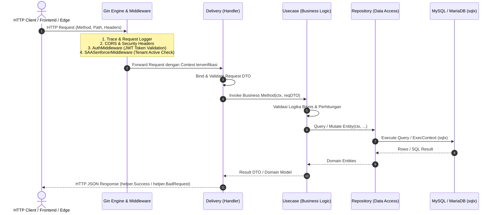
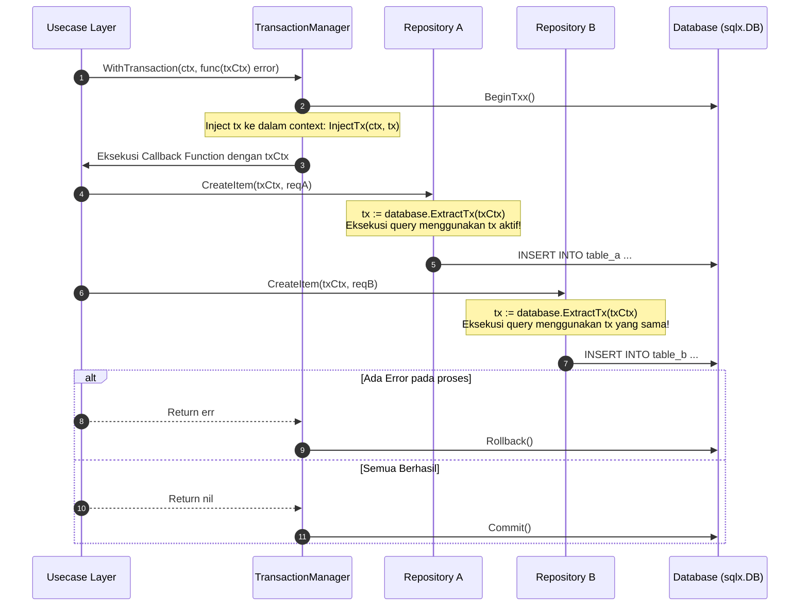
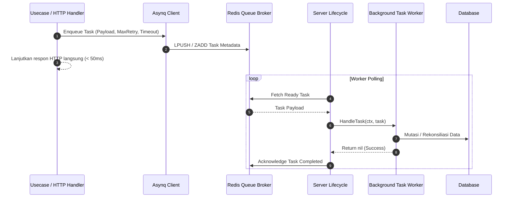

# Go Clean Architecture & Tech Stack Boilerplate Blueprint
> **Basis Standar**: Arsitektur Produksi `park-server-v3`  
> **Pola Desain**: *Domain-Driven Modular Monolith* dengan *Explicit Dependency Injection* dan *Context-Aware Transaction Management*.

Dokumen ini adalah template komprehensif untuk merancang, menginisialisasi, dan membangun backend server Go berskala produksi yang kokoh, mudah diuji (*testable*), aman (*SaaS multi-tenant ready*), dan terstruktur rapi.

---

## 1. Tech Stack & Recommended Libraries

Semua pustaka berikut dipilih karena performa tinggi, kestabilan, tipe aman (*type-safe*), dan kemudahan integrasi:

| Kategori | Modul / Library | Versi Rekomendasi | Fungsi & Alasan Penggunaan |
| :--- | :--- | :--- | :--- |
| **Language & Runtime** | `Go` | `1.24+` / `1.26+` | Bahasa utama. Wajib menyematkan `_ "time/tzdata"` dan timezone default WIB (`+07:00`) untuk penyeragaman timestamp log & database. |
| **HTTP Web Framework** | `github.com/gin-gonic/gin` | `v1.12.0+` | Router berkecepatan tinggi dengan alokasi memori minimal, middleware chaining yang fleksibel, dan kemudahan pembuatan sub-router group. |
| **Database Access & ORM** | `github.com/jmoiron/sqlx` | `v1.4.0+` | Ekstensi `database/sql` standar. Memberikan mapping struct otomatis (`db:"..."`), named queries, dan performa SQL murni tanpa kompleksitas "magic" ORM berat. |
| **Database Driver** | `github.com/go-sql-driver/mysql` | `v1.9.0+` | Driver MySQL / MariaDB resmi berkinerja tinggi dengan dukungan `parseTime=true` dan connection pooling bawaan. |
| **Database Migration** | `github.com/pressly/goose/v3` | `v3.24.0+` | Manajemen migrasi skema SQL versi terstruktur (up/down migration) yang mendukung embedded binary. |
| **Distributed Queue & Worker** | `github.com/hibiken/asynq` | `v0.25.0+` | Antrean tugas latar belakang (*background job queue*) terdistribusi berbasis Redis. Menyediakan otomatis retry, dead-letter queue, task prioritization, dan scheduler periodik (cron). |
| **Distributed Cache & State** | `github.com/redis/go-redis/v9` | `v9.7.0+` | Client Redis modern dengan context support, pipelining, rate limiter storage, dan pub/sub. |
| **Security & JWT** | `github.com/golang-jwt/jwt/v5` | `v5.2.0+` | Token autentikasi berbasis Scoped Access Claims (`user_id`, `role_code`, `tenant_id`, `branch_id`). |
| **Password Hashing** | `golang.org/x/crypto/bcrypt` | `v0.33.0+` | Standar industri untuk hashing dan verifikasi PIN/password dengan salt otomatis. |
| **Precision Arithmetic** | `github.com/shopspring/decimal` | `v1.4.0+` | Operasi floating-point fixed-precision murni untuk nilai uang, tarif, dan laporan finansial guna menghindari *IEEE 754 rounding errors*. |
| **Structured Logging** | `go.uber.org/zap` | `v1.27.0+` | Logger JSON terstruktur tercepat di ekosistem Go. Dilengkapi middleware sanitasi/redaksi otomatis untuk field sensitif (`password`, `token`, `secret`, `pin`). |
| **Resilience & Fault Tolerance** | `github.com/sony/gobreaker` | `v1.0.0+` | Circuit Breaker untuk mengisolasi request ke API eksternal (Payment Gateway, OCR, S3) agar tidak memicu *thread starvation*. |
| **Object Storage** | `github.com/aws/aws-sdk-go-v2` | `v1.36.0+` | SDK S3 resmi yang kompatibel dengan SeaweedFS S3 Gateway, MinIO, maupun AWS S3. |
| **Observability (Tracing & Metrics)**| `go.opentelemetry.io/otel`<br>`github.com/prometheus/client_golang` | `v1.34.0+`<br>`v1.22.0+` | Distributed tracing (OTLP gRPC) dan monitoring metrik aplikasi via Prometheus `/metrics`. |
| **API Documentation** | `github.com/swaggo/gin-swagger`<br>`github.com/swaggo/swag` | `v1.6.0+`<br>`v1.16.4+` | Generasi Swagger / OpenAPI 3.0 otomatis langsung dari deklarasi komentar Go code. |
| **Testing Suite** | `github.com/stretchr/testify`<br>`github.com/DATA-DOG/go-sqlmock`<br>`github.com/testcontainers/testcontainers-go` | `v1.10.0+`<br>`v1.5.2+`<br>`v0.35.0+` | Toolkit pengujian komprehensif: assertions/mocks, SQL driver mock, dan live container testing (MySQL/Redis nyata di Docker). |

---

## 2. Struktur Folder (*Domain-Driven Modular Monolith*)

Struktur proyek disusun agar setiap modul domain bisnis terisolasi mandiri, memisahkan *business logic* dari detail teknis (framework/database):

```text
├── cmd/
│   └── api/
│       └── main.go                  # Entry point aplikasi: Load config, init logger & server
├── config/
│   └── config.go                    # Parsing environment variable (.env) ke Typed Struct
├── internal/
│   ├── <domain_name>/               # Contoh: parking, financial, identity, sync, hardware
│   │   ├── model/                   # Database Entities & DTO (Data Transfer Objects)
│   │   │   ├── <entity>.go          # Struct tabel database (db:"...") & JSON mapping
│   │   │   └── dto.go               # Request binding & Response structures
│   │   ├── repository/              # Data Access Layer (SQL queries, sqlx, ExtractTx)
│   │   │   ├── <entity>_repository.go
│   │   │   └── <entity>_repository_test.go
│   │   ├── usecase/                 # Pure Business Logic & Orchestration
│   │   │   ├── <entity>_usecase.go
│   │   │   └── <entity>_usecase_test.go
│   │   ├── delivery/                # HTTP Delivery (Gin Handlers & Sub-routing)
│   │   │   ├── <entity>_handler.go
│   │   │   ├── <entity>_handler_test.go
│   │   │   └── router.go            # Pemetaan sub-rute domain
│   │   ├── worker/                  # (Opsional) Asynq background workers & scheduled cron
│   │   │   └── <task>_worker.go
│   │   └── listener/                # (Opsional) Internal event bus subscribers
│   │       └── <event>_listener.go
│   ├── delivery/
│   │   └── http/
│   │       ├── container.go         # Central Dependency Injection (DI) Container
│   │       └── router.go            # Root Gin Engine, Global Middlewares & Route Groups
│   └── server/
│       └── server.go                # Dual Engine Runner (HTTP Server + Asynq Worker) & Graceful Shutdown
├── pkg/                             # Shared, reusable packages across all domains
│   ├── database/                    # Connection pool, transaction wrapper (ExtractTx, WithTransaction)
│   │   ├── connection.go
│   │   └── tx.go
│   ├── helper/                      # Penyeragaman respon JSON (Success, BadRequest, CursorPagination)
│   │   └── response.go
│   ├── logger/                      # Zap logger wrapper & automatic field redaction
│   │   ├── logger.go
│   │   └── redact.go
│   ├── middleware/                  # Security, Auth, SaaS Enforcer, Rate Limiter, Tracing
│   │   ├── auth.go                  # JWT validator & context injector
│   │   ├── saas_enforcer.go         # Tenant Kill-Switch enforcement
│   │   ├── tenant_guard.go          # Anti-IDOR tenant & branch context guards
│   │   ├── security_headers.go      # OWASP security headers
│   │   └── logger.go                # HTTP request logger & trace propagation
│   ├── resilience/                  # Circuit breaker wrapper (GoBreaker)
│   │   └── circuit_breaker.go
│   ├── security/                    # JWT token generator, validator & password hasher
│   │   ├── jwt.go
│   │   └── hash.go
│   ├── storage/                     # S3-compatible client (AWS, SeaweedFS, MinIO)
│   │   └── s3.go
│   └── util/                        # Generic helpers, code generator (public codes, UUID)
│       ├── code.go
│       └── time.go
├── migrations/                      # Goose SQL migration scripts
│   ├── 00001_init_schema.sql
│   └── 00002_add_indexes.sql
├── .env.example                     # Contoh template konfigurasi environment
├── go.mod                           # Go Module definition
└── go.sum                           # Go Module checksums
```

---

## 3. Alur Komunikasi Antar Layer

### A. Alur Permintaan HTTP Standar


### B. Alur Transaksi Database Atomic (`ExtractTx`)
Ketika sebuah aksi membutuhkan mutasi di banyak tabel secara konsisten (ACID), transaksi dikelola di layer **Usecase** tanpa mencemari usecase dengan objek `sql.Tx` mentah:


### C. Alur Background Task (Asynq)


---

## 4. Boilerplate Kode Standar Siap Pakai

### A. Model & DTO (`internal/<domain>/model/entity.go`)
```go
package model

import (
	"time"

	"github.com/shopspring/decimal"
)

// Entity tabel database murni
type ParkingSession struct {
	ID           int64           `db:"id" json:"id"`
	Code         string          `db:"code" json:"code"`
	TenantID     int64           `db:"tenant_id" json:"tenant_id"`
	BranchID     int64           `db:"branch_id" json:"branch_id"`
	PlateNumber  string          `db:"plate_number" json:"plate_number"`
	VehicleType  string          `db:"vehicle_type" json:"vehicle_type"`
	CheckInTime  time.Time       `db:"check_in_time" json:"check_in_time"`
	CheckOutTime *time.Time      `db:"check_out_time" json:"check_out_time,omitempty"`
	Amount       decimal.Decimal `db:"amount" json:"amount"`
	Status       string          `db:"status" json:"status"` // ACTIVE, FINISHED, CANCELLED
	CreatedAt    time.Time       `db:"created_at" json:"created_at"`
	UpdatedAt    time.Time       `db:"updated_at" json:"updated_at"`
}

// Request DTO (dilengkapi binding validation tag)
type CreateParkingSessionRequest struct {
	PlateNumber string `json:"plate_number" binding:"required,min=3,max=15"`
	VehicleType string `json:"vehicle_type" binding:"required,oneof=CAR MOTORCYCLE BUS TRUCK"`
}

// Response DTO
type ParkingSessionResponse struct {
	SessionCode string          `json:"session_code"`
	PlateNumber string          `json:"plate_number"`
	VehicleType string          `json:"vehicle_type"`
	CheckInTime time.Time       `json:"check_in_time"`
	Amount      decimal.Decimal `json:"amount"`
	Status      string          `json:"status"`
}
```

---

### B. Repository Layer (`internal/<domain>/repository/entity_repository.go`)
```go
package repository

import (
	"context"
	"fmt"

	"<app_module>/internal/<domain>/model"
	"<app_module>/pkg/database"

	"github.com/jmoiron/sqlx"
)

type ParkingSessionRepository interface {
	Create(ctx context.Context, session *model.ParkingSession) error
	GetByCode(ctx context.Context, code string) (*model.ParkingSession, error)
	GetList(ctx context.Context, branchID int64, cursor uint64, limit int) ([]model.ParkingSession, *uint64, bool, error)
	Update(ctx context.Context, session *model.ParkingSession) error
}

type parkingSessionRepository struct {
	db *sqlx.DB
}

func NewParkingSessionRepository(db *sqlx.DB) ParkingSessionRepository {
	return &parkingSessionRepository{db: db}
}

func (r *parkingSessionRepository) Create(ctx context.Context, s *model.ParkingSession) error {
	query := `
		INSERT INTO park_sessions 
			(code, tenant_id, branch_id, plate_number, vehicle_type, check_in_time, amount, status, created_at, updated_at)
		VALUES 
			(:code, :tenant_id, :branch_id, :plate_number, :vehicle_type, :check_in_time, :amount, :status, :created_at, :updated_at)
	`
	// Otomatis mengekstrak transaksi aktif bila dibungkus txManager.WithTransaction
	if tx := database.ExtractTx(ctx); tx != nil {
		_, err := tx.NamedExecContext(ctx, query, s)
		return err
	}

	_, err := r.db.NamedExecContext(ctx, query, s)
	return err
}

func (r *parkingSessionRepository) GetByCode(ctx context.Context, code string) (*model.ParkingSession, error) {
	var item model.ParkingSession
	query := `SELECT * FROM park_sessions WHERE code = ? LIMIT 1`

	if tx := database.ExtractTx(ctx); tx != nil {
		err := tx.GetContext(ctx, &item, query, code)
		return &item, err
	}

	err := r.db.GetContext(ctx, &item, query, code)
	return &item, err
}

// Standar Universal Cursor-based Pagination
func (r *parkingSessionRepository) GetList(ctx context.Context, branchID int64, cursor uint64, limit int) ([]model.ParkingSession, *uint64, bool, error) {
	if limit <= 0 {
		limit = 10
	}
	fetchLimit := limit + 1

	var query string
	var args []interface{}

	if cursor == 0 {
		query = `SELECT * FROM park_sessions WHERE branch_id = ? ORDER BY id DESC LIMIT ?`
		args = []interface{}{branchID, fetchLimit}
	} else {
		query = `SELECT * FROM park_sessions WHERE branch_id = ? AND id <= ? ORDER BY id DESC LIMIT ?`
		args = []interface{}{branchID, cursor, fetchLimit}
	}

	var items []model.ParkingSession
	if err := r.db.SelectContext(ctx, &items, query, args...); err != nil {
		return nil, nil, false, err
	}

	hasMore := len(items) > limit
	var nextCursor *uint64

	if hasMore {
		items = items[:limit]
		lastID := uint64(items[len(items)-1].ID)
		nextCursor = &lastID
	}

	return items, nextCursor, hasMore, nil
}

func (r *parkingSessionRepository) Update(ctx context.Context, s *model.ParkingSession) error {
	query := `
		UPDATE park_sessions SET
			check_out_time = :check_out_time,
			amount = :amount,
			status = :status,
			updated_at = :updated_at
		WHERE code = :code
	`
	if tx := database.ExtractTx(ctx); tx != nil {
		_, err := tx.NamedExecContext(ctx, query, s)
		return err
	}

	_, err := r.db.NamedExecContext(ctx, query, s)
	return err
}
```

---

### C. Usecase Layer (`internal/<domain>/usecase/entity_usecase.go`)
```go
package usecase

import (
	"context"
	"errors"
	"fmt"
	"time"

	"<app_module>/internal/<domain>/model"
	"<app_module>/internal/<domain>/repository"
	"<app_module>/pkg/database"
	"<app_module>/pkg/util"

	"github.com/shopspring/decimal"
)

type ParkingSessionUsecase interface {
	CheckIn(ctx context.Context, tenantID, branchID int64, req model.CreateParkingSessionRequest) (*model.ParkingSessionResponse, error)
	GetSessionList(ctx context.Context, branchID int64, cursor uint64, limit int) ([]model.ParkingSessionResponse, *uint64, bool, error)
}

type parkingSessionUsecase struct {
	repo      repository.ParkingSessionRepository
	txManager database.TransactionManager
}

func NewParkingSessionUsecase(repo repository.ParkingSessionRepository, txManager database.TransactionManager) ParkingSessionUsecase {
	return &parkingSessionUsecase{
		repo:      repo,
		txManager: txManager,
	}
}

func (u *parkingSessionUsecase) CheckIn(ctx context.Context, tenantID, branchID int64, req model.CreateParkingSessionRequest) (*model.ParkingSessionResponse, error) {
	now := util.NowWIB()
	sessionCode := util.GeneratePublicCode("SESS")

	session := &model.ParkingSession{
		Code:        sessionCode,
		TenantID:    tenantID,
		BranchID:    branchID,
		PlateNumber: req.PlateNumber,
		VehicleType: req.VehicleType,
		CheckInTime: now,
		Amount:      decimal.Zero,
		Status:      "ACTIVE",
		CreatedAt:   now,
		UpdatedAt:   now,
	}

	// Eksekusi di dalam transaksi database yang terisolasi aman
	err := u.txManager.WithTransaction(ctx, func(txCtx context.Context) error {
		if err := u.repo.Create(txCtx, session); err != nil {
			return fmt.Errorf("failed to create session: %w", err)
		}
		return nil
	})

	if err != nil {
		return nil, err
	}

	return &model.ParkingSessionResponse{
		SessionCode: session.Code,
		PlateNumber: session.PlateNumber,
		VehicleType: session.VehicleType,
		CheckInTime: session.CheckInTime,
		Amount:      session.Amount,
		Status:      session.Status,
	}, nil
}

func (u *parkingSessionUsecase) GetSessionList(ctx context.Context, branchID int64, cursor uint64, limit int) ([]model.ParkingSessionResponse, *uint64, bool, error) {
	items, nextCursor, hasMore, err := u.repo.GetList(ctx, branchID, cursor, limit)
	if err != nil {
		return nil, nil, false, err
	}

	var res []model.ParkingSessionResponse
	for _, item := range items {
		res = append(res, model.ParkingSessionResponse{
			SessionCode: item.Code,
			PlateNumber: item.PlateNumber,
			VehicleType: item.VehicleType,
			CheckInTime: item.CheckInTime,
			Amount:      item.Amount,
			Status:      item.Status,
		})
	}

	return res, nextCursor, hasMore, nil
}
```

---

### D. Delivery / HTTP Handler Layer (`internal/<domain>/delivery/entity_handler.go`)
```go
package delivery

import (
	"net/http"
	"strconv"

	"<app_module>/internal/<domain>/model"
	"<app_module>/internal/<domain>/usecase"
	"<app_module>/pkg/helper"
	"<app_module>/pkg/middleware"

	"github.com/gin-gonic/gin"
)

type ParkingSessionHandler struct {
	uc usecase.ParkingSessionUsecase
}

func NewParkingSessionHandler(uc usecase.ParkingSessionUsecase) *ParkingSessionHandler {
	return &ParkingSessionHandler{uc: uc}
}

// CheckIn godoc
// @Summary Check-in tiket sesi parkir baru
// @Tags Parking Session
// @Accept json
// @Produce json
// @Param request body model.CreateParkingSessionRequest true "Payload check-in"
// @Success 201 {object} helper.Response{data=model.ParkingSessionResponse}
// @Failure 400 {object} helper.Response
// @Failure 401 {object} helper.Response
// @Router /api/v1/parking/sessions/check-in [post]
func (h *ParkingSessionHandler) CheckIn(c *gin.Context) {
	// 1. Ekstrak identitas cabang & tenant murni dari JWT context (Strict Anti-IDOR)
	branchID, ok := middleware.GetContextBranchID(c)
	if !ok || branchID <= 0 {
		helper.BadRequest(c, "Token otentikasi tidak terikat pada cabang yang sah", nil)
		return
	}
	tenantID, _ := middleware.GetContextTenantID(c)

	// 2. Bind & Validate JSON Payload
	var req model.CreateParkingSessionRequest
	if err := c.ShouldBindJSON(&req); err != nil {
		helper.BadRequest(c, "Data input tidak valid: "+err.Error(), nil)
		return
	}

	// 3. Panggil Usecase
	resp, err := h.uc.CheckIn(c.Request.Context(), tenantID, branchID, req)
	if err != nil {
		helper.InternalServerError(c, "Gagal memproses sesi parkir", err.Error())
		return
	}

	helper.Created(c, "Sesi parkir berhasil dibuat", resp)
}

// GetList godoc
// @Summary Mengambil daftar riwayat sesi parkir cabang (Cursor Pagination)
// @Tags Parking Session
// @Produce json
// @Param cursor query int false "ID cursor awal"
// @Param limit query int false "Batas jumlah per halaman (default 10)"
// @Success 200 {object} helper.Response{data=helper.CursorPaginationResponse[model.ParkingSessionResponse]}
// @Router /api/v1/parking/sessions [get]
func (h *ParkingSessionHandler) GetList(c *gin.Context) {
	branchID, ok := middleware.GetContextBranchID(c)
	if !ok || branchID <= 0 {
		helper.BadRequest(c, "Cabang tidak terotorisasi", nil)
		return
	}

	limit, _ := strconv.Atoi(c.DefaultQuery("limit", "10"))
	var cursor uint64
	if cur := c.Query("cursor"); cur != "" {
		if parsed, err := strconv.ParseUint(cur, 10, 64); err == nil {
			cursor = parsed
		}
	}

	items, nextCursor, hasMore, err := h.uc.GetSessionList(c.Request.Context(), branchID, cursor, limit)
	if err != nil {
		helper.InternalServerError(c, "Gagal memuat sesi parkir", err.Error())
		return
	}

	if items == nil {
		items = []model.ParkingSessionResponse{}
	}

	helper.Success(c, "Daftar sesi parkir berhasil dimuat", helper.CursorPaginationResponse[model.ParkingSessionResponse]{
		Items:      items,
		NextCursor: nextCursor,
		HasMore:    hasMore,
	})
}

// Sub-routing domain
func RegisterParkingRoutes(protectedGroup *gin.RouterGroup, h *ParkingSessionHandler) {
	group := protectedGroup.Group("/parking/sessions")
	{
		group.POST("/check-in", h.CheckIn)
		group.GET("", h.GetList)
	}
}
```

---

### E. Dependency Injection Container (`internal/delivery/http/container.go`)
```go
package http

import (
	parkingDel "<app_module>/internal/parking/delivery"
	parkingRepo "<app_module>/internal/parking/repository"
	parkingUc "<app_module>/internal/parking/usecase"
	"<app_module>/pkg/database"
	"<app_module>/pkg/security"

	"github.com/gin-gonic/gin"
	"github.com/hibiken/asynq"
	"github.com/jmoiron/sqlx"
	"github.com/redis/go-redis/v9"
)

type Container struct {
	db             *sqlx.DB
	rdb            *redis.Client
	txManager      database.TransactionManager
	tokenManager   *security.JWTTokenManager
	queueClient    *asynq.Client
	queueServer    *asynq.Server
	queueScheduler *asynq.Scheduler
}

func NewContainer(
	db *sqlx.DB,
	rdb *redis.Client,
	tokenManager *security.JWTTokenManager,
	queueClient *asynq.Client,
	queueServer *asynq.Server,
	queueScheduler *asynq.Scheduler,
) *Container {
	return &Container{
		db:             db,
		rdb:            rdb,
		txManager:      database.NewTransactionManager(db),
		tokenManager:   tokenManager,
		queueClient:    queueClient,
		queueServer:    queueServer,
		queueScheduler: queueScheduler,
	}
}

func (c *Container) RegisterAllModules(publicApi, protectedTenantApi, protectedJWTApi *gin.RouterGroup) {
	// 1. Inisialisasi Parking Domain
	parkRepo := parkingRepo.NewParkingSessionRepository(c.db)
	parkUsecase := parkingUc.NewParkingSessionUsecase(parkRepo, c.txManager)
	parkHandler := parkingDel.NewParkingSessionHandler(parkUsecase)
	
	// Daftarkan ke router yang dilindungi JWT & SaaS Enforcer
	parkingDel.RegisterParkingRoutes(protectedTenantApi, parkHandler)

	// 2. Modul domain lainnya diinisialisasi secara eksplisit di sini...
}
```

---

### F. Routing & 3-Tier Security Hierarchy (`internal/delivery/http/router.go`)
```go
package http

import (
	"<app_module>/pkg/middleware"
	"<app_module>/pkg/security"

	"github.com/gin-contrib/cors"
	"github.com/gin-gonic/gin"
	"github.com/jmoiron/sqlx"
)

func NewRouter(container *Container, db *sqlx.DB, tm *security.JWTTokenManager) *gin.Engine {
	r := gin.New()

	// Global Middlewares
	r.Use(gin.Recovery())
	r.Use(middleware.LoggerMiddleware())
	r.Use(middleware.SecurityHeadersMiddleware())
	r.Use(cors.New(cors.Config{
		AllowAllOrigins:  true,
		AllowMethods:     []string{"GET", "POST", "PUT", "PATCH", "DELETE", "OPTIONS"},
		AllowHeaders:     []string{"Origin", "Content-Type", "Accept", "Authorization", "X-Requested-With"},
		ExposeHeaders:    []string{"Content-Length"},
		AllowCredentials: true,
	}))

	api := r.Group("/api/v1")

	// TIER 1: Rute Terbuka untuk Publik (Login, Webhook Midtrans, Static Assets)
	publicApi := api.Group("")

	// TIER 2: Rute Terikat Tenant (Auth JWT + SaaS Kill-Switch Enforcer)
	protectedTenantApi := api.Group("")
	protectedTenantApi.Use(middleware.AuthMiddleware(tm))
	protectedTenantApi.Use(middleware.SAASenforcerMiddleware(db))

	// TIER 3: Rute Personal / Cross-Tenant (Hanya Verifikasi Signature JWT)
	protectedJWTApi := api.Group("")
	protectedJWTApi.Use(middleware.AuthMiddleware(tm))

	// Daftarkan seluruh modul melalui container
	container.RegisterAllModules(publicApi, protectedTenantApi, protectedJWTApi)

	return r
}
```

---

### G. Server Lifecycle & Dual Runner (`internal/server/server.go`)
```go
package server

import (
	"context"
	"log"
	"net/http"
	"os"
	"os/signal"
	"syscall"
	"time"

	"github.com/gin-gonic/gin"
	"github.com/hibiken/asynq"
)

type Server struct {
	httpServer     *http.Server
	queueServer    *asynq.Server
	queueScheduler *asynq.Scheduler
	queueMux       *asynq.ServeMux
}

func NewServer(
	router *gin.Engine,
	port string,
	queueServer *asynq.Server,
	queueScheduler *asynq.Scheduler,
	queueMux *asynq.ServeMux,
) *Server {
	return &Server{
		httpServer: &http.Server{
			Addr:         ":" + port,
			Handler:      router,
			ReadTimeout:  30 * time.Second,
			WriteTimeout: 30 * time.Second,
		},
		queueServer:    queueServer,
		queueScheduler: queueScheduler,
		queueMux:       queueMux,
	}
}

func (s *Server) Run() error {
	// Jalankan Asynq Scheduler (Periodic Cron)
	if s.queueScheduler != nil {
		if err := s.queueScheduler.Start(); err != nil {
			log.Printf("[Queue] Failed to start scheduler: %v", err)
		}
	}

	// Jalankan Asynq Worker Pool
	if s.queueServer != nil && s.queueMux != nil {
		go func() {
			if err := s.queueServer.Run(s.queueMux); err != nil {
				log.Printf("[Queue] Worker server error: %v", err)
			}
		}()
	}

	// Jalankan HTTP Server
	go func() {
		log.Printf("[HTTP] Server listening on %s", s.httpServer.Addr)
		if err := s.httpServer.ListenAndServe(); err != nil && err != http.ErrServerClosed {
			log.Fatalf("[HTTP] Listen error: %v", err)
		}
	}()

	// Graceful Shutdown Listening OS Signals
	quit := make(chan os.Signal, 1)
	signal.Notify(quit, os.Interrupt, syscall.SIGTERM)
	<-quit

	log.Println("[Server] Shutting down gracefully...")

	ctx, cancel := context.WithTimeout(context.Background(), 10*time.Second)
	defer cancel()

	if s.queueScheduler != nil {
		s.queueScheduler.Shutdown()
	}
	if s.queueServer != nil {
		s.queueServer.Shutdown()
	}

	return s.httpServer.Shutdown(ctx)
}
```

---

## 5. Golden Rules & Prinsip Integritas

1. **Strict Zero Dummy Data & Pure Server State**:
   - Dilarang membuat, menyisipkan, atau mempertahankan *dummy data*, *mock array*, atau *fallback object* di dalam blok `catch` untuk mengelabui UI.
   - Jika data belum ada, kembalikan slice kosong (`[]`), `nil`, atau lempar error spesifik (`404` / `400`).
2. **Anti-IDOR & Strict JWT Context Extraction**:
   - Dilarang mengambil `tenant_id` atau `branch_id` dari query string atau request body untuk aksi operasional.
   - Nilai identitas hak akses **wajib diekstrak dari JWT claims** yang sudah diverifikasi oleh `AuthMiddleware` (`middleware.GetContextBranchID(c)`).
3. **Cursor-Based Pagination Only**:
   - Dilarang keras menggunakan pagination `LIMIT ... OFFSET ...` pada tabel transaksi operasional bervolume besar.
   - Selalu gunakan `WHERE id <= :cursor ORDER BY id DESC LIMIT :limit + 1`.
4. **Precision Arithmetic**:
   - Seluruh variabel moneter / tarif uang wajib menggunakan tipe `decimal.Decimal` (`github.com/shopspring/decimal`), bukan `float32` atau `float64`.
5. **No Emojis in Backend**:
   - Data status di database dan response JSON harus berupa string kapital standar (`"ACTIVE"`, `"PENDING"`, `"SUSPENDED"`). Dilarang menyisipkan karakter emoji visual (seperti `🟢`, `🔴`, `⚠️`). Representasi ikon diserahkan 100% ke layer frontend.
