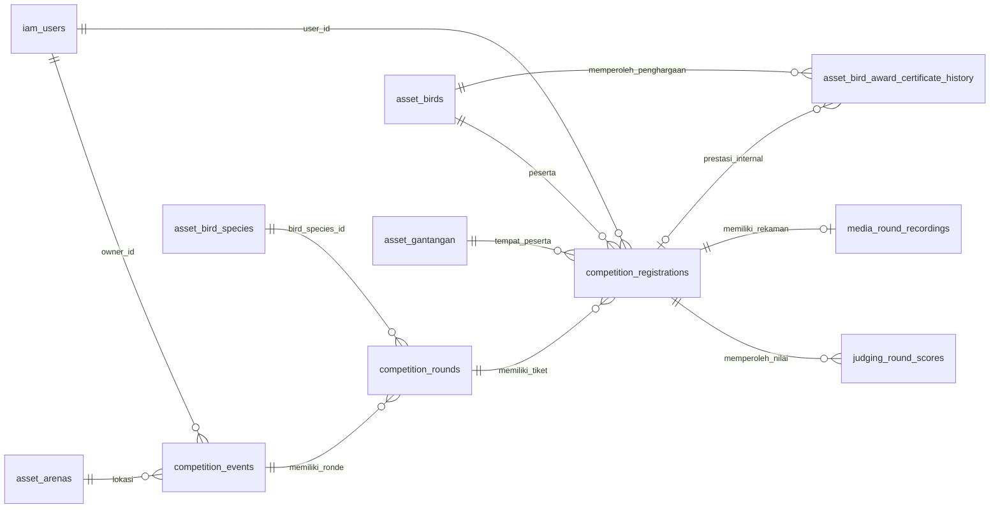
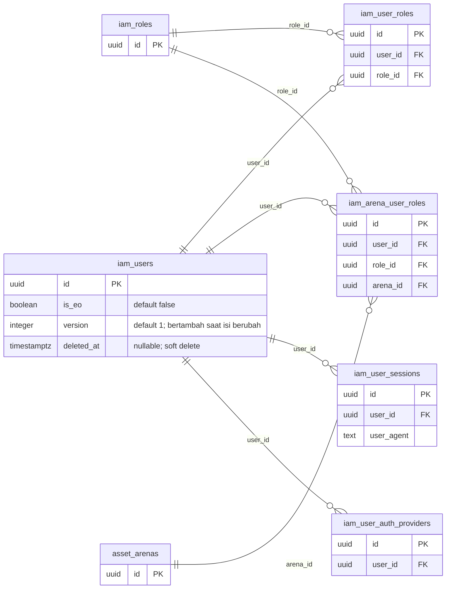
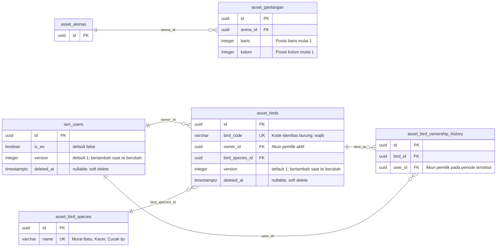
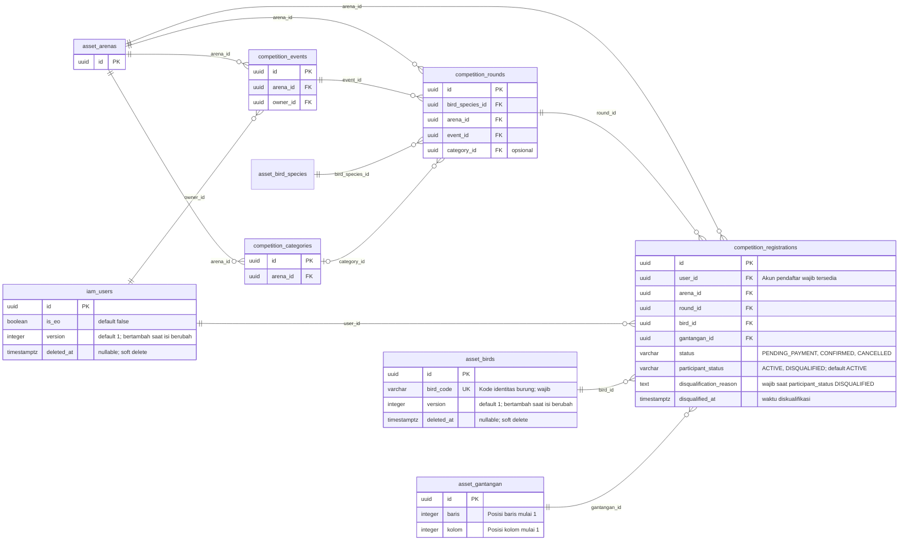
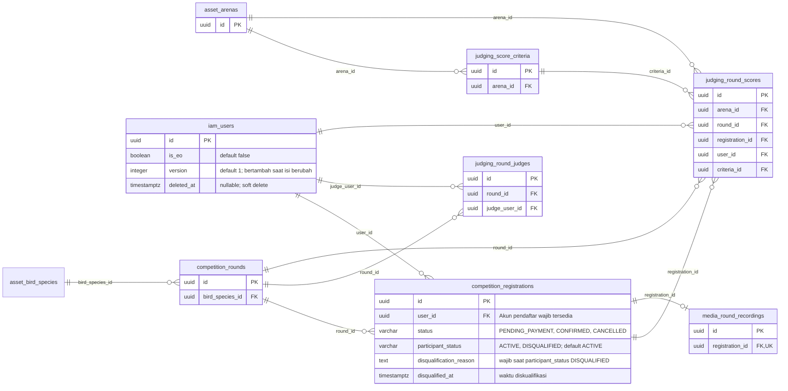
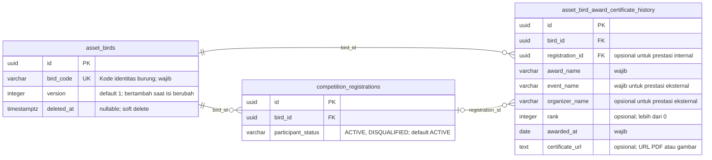
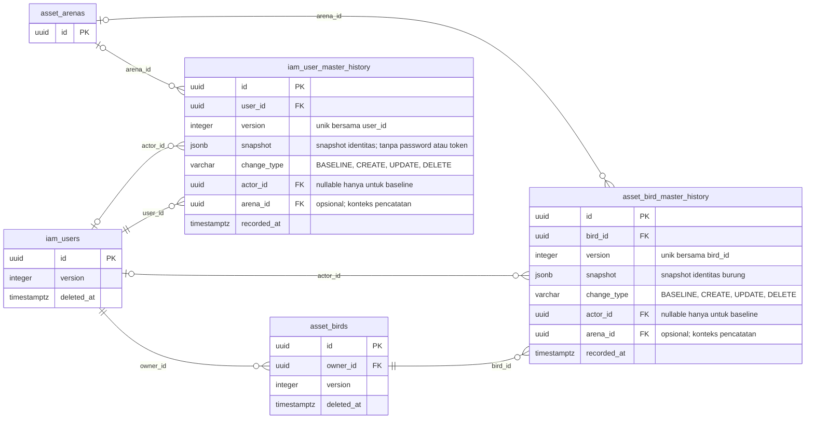
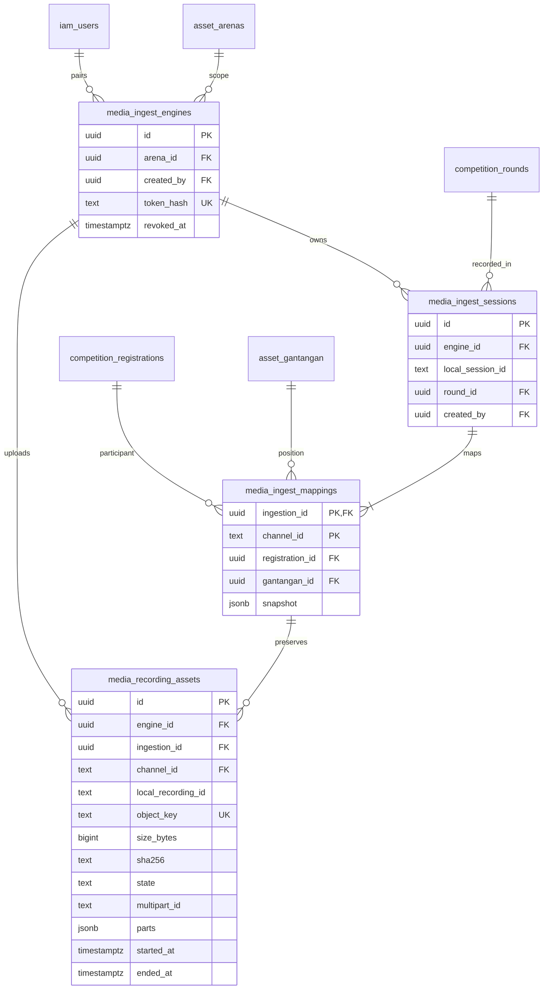

# Rancangan ERD Lengkap Kicau Mania (Multi-Arena & EO)

> **Status — RANCANGAN SCHEMA 011, HISTORY MASTER, SOFT DELETE DAN MEDIA DESKTOP**
>
> Tanggal revisi: 15 November 2026. Rancangan mencakup migrasi 008–011. Penerapan pada database dilakukan terpisah; perubahan media desktop ini tidak mereset atau memigrasikan database operasional/VPS otomatis.
> Rancangan ini menyederhanakan arsitektur database dengan:
> 1. Menghapus tabel perantara dan audit mikro (`asset_owners`, `asset_bird_owner_transfers`, `competition_registration_items`, `competition_registration_payments`, `judging_participant_assessments`, `judging_score_operations`, `judging_score_revisions`).
> 2. Menyimpan EO sebagai akun `iam.users` dengan boolean `is_eo`; event terhubung langsung ke akun penyelenggara melalui `owner_id`. Arena tetap merupakan fasilitas fisik terpisah.
> 3. Memastikan `arena_id` selalu wajib (`NOT NULL`) pada event, serta memungkinkan **rekapan analitik riwayat EO pernah mengadakan lomba di arena mana saja**.
> 4. Menyediakan **kustomisasi jumlah ronde yang fleksibel** (1 s/d N ronde) per event di masing-masing arena.
> 5. Menyederhanakan registrasi menjadi entitas tunggal (1 tiket = 1 burung di 1 ronde & 1 gantangan) lengkap dengan kolom BLOB bukti bayar transfer.
> 6. Menyederhanakan penilaian juri: revisi nilai langsung **ditimpa (`UPDATE`)** pada `judging.round_scores`.
> 7. Menyimpan token lupa password dan verifikasi email sementara di Redis, di luar tabel PostgreSQL.
> 8. Memisahkan status peserta dari registrasi dan pembayaran, serta mencatat penghargaan internal maupun eksternal per burung.
> 9. Menyimpan snapshot awal dan versi baru master peserta/burung pada history append-only; data identik tidak menambah versi.
> 10. Memakai soft delete dan pemeriksaan versi untuk mencegah perubahan admin saling menimpa. Role bisnis hanya `ADMIN`, `OPERATOR`, `JURI`, dan `PESERTA`.

---

## 0. Peta Relasi Antar Tabel

Bagian ini memecah diagram lengkap menjadi beberapa tampilan. Mulai dari peta utama, lalu lihat diagram per bagian untuk menelusuri foreign key.

**Cakupan:** diagram mengikuti schema 008–010, termasuk history master, versi data, soft delete dan empat role. Migrasi 004–007 tetap menjadi riwayat schema lama. Privilege/trigger database dan query SQL sudah tersedia; otorisasi dan transaksi UseCase, Redis serta endpoint/API belum diadaptasi. Detail status pada [panduan database](README.md) dan [panduan query bisnis](queries/README.md).

### Navigasi

- [Peta utama: arena sampai rekaman](#01-peta-utama-arena-sampai-rekaman)
- [Akun dan hak akses](#02-akun-dan-hak-akses)
- [Fasilitas arena dan kepemilikan burung](#03-fasilitas-arena-dan-kepemilikan-burung)
- [EO, event, ronde, dan tiket](#04-eo-event-ronde-dan-tiket)
- [Penjurian, pemenang, dan rekaman](#05-penjurian-pemenang-dan-rekaman)
- [Referensi foreign key](#06-referensi-foreign-key)
- [Riwayat penghargaan dan sertifikat](#07-riwayat-penghargaan-dan-sertifikat)
- [History master peserta dan burung](#08-history-master-peserta-dan-burung)
- [Diagram lengkap beserta atribut](#1-diagram-hubungan-entitas-lengkap-erd-mermaid)

### Cara membaca diagram

| Notasi | Arti pada ujung garis |
| :--- | :--- |
| `||` | Tepat satu, wajib |
| `o|` atau `|o` | Nol atau satu, opsional |
| `o{` atau `}o` | Nol sampai banyak |
| `PK` | Primary key, identitas baris |
| `FK` | Foreign key, referensi ke tabel lain |
| `UK` | Unique key, nilai harus unik |

Contoh: `competition_events ||--o{ competition_rounds` berarti satu event dapat memiliki nol sampai banyak ronde; setiap ronde wajib mengacu ke tepat satu event. Event yang sedang disiapkan boleh belum memiliki ronde, walaupun event siap lomba secara bisnis membutuhkan minimal satu ronde.

Nama node memakai underscore: `competition_rounds` berarti `competition.rounds`. Label garis pada diagram detail menyebut kolom FK di tabel anak. Tabel yang muncul di beberapa diagram adalah tabel yang sama, bukan tabel tambahan. Diagram detail hanya menampilkan kolom kunci agar relasinya mudah dibaca.

### 0.1 Peta utama: arena sampai rekaman

**Intinya:** akun dengan `is_eo = true` menyelenggarakan event di arena. Event memiliki ronde; setiap tiket menghubungkan satu ronde, satu burung, dan satu gantangan. Nilai dan rekaman mengacu ke tiket tersebut. Penghargaan selalu mengacu ke burung dan boleh mengacu ke tiket lomba internal. Hubungan EO dengan arena bersifat **banyak-ke-banyak melalui event**, sehingga riwayat kerja sama dapat ditelusuri tanpa tabel penghubung tambahan.

### 0.2 Akun dan hak akses

`iam.users.is_eo` menandai apakah akun merupakan EO (default `false`). `user_roles` menghubungkan akun dengan role global. `arena_user_roles` menambahkan lingkup arena: akun yang sama dapat memiliki penugasan berbeda di arena berbeda. Akun juga menjadi referensi pemilik burung, penyelenggara EO, pendaftar, dan juri pada diagram berikutnya.

Role bisnis terdiri dari `ADMIN`, `OPERATOR`, `JURI`, dan `PESERTA`. ADMIN dan OPERATOR mengelola event, ronde, dan tiket hanya pada arena penugasannya; CRUD arena hanya ADMIN. ADMIN yang membuat arena otomatis mendapat penugasan ADMIN di arena baru. Penanda role akun tidak memberi akses otomatis ke semua arena. JURI memberi skor hanya pada ronde penugasannya.

Master peserta dan burung tetap merupakan data bersama yang dapat dikelola petugas ADMIN/OPERATOR. Akses read-only ke history berarti tidak ada form atau query edit/hapus history bagi petugas; perubahan master hanya menambahkan versi melalui sistem.

Token lupa password dan verifikasi email disimpan di Redis dengan masa berlaku (TTL) dan dikonsumsi sekali saat berhasil digunakan. PostgreSQL tetap menyimpan hasil verifikasi pada `iam.users.email_verified_at`. Redis tidak ditampilkan sebagai tabel atau FK pada ERD.

### 0.3 Fasilitas arena dan kepemilikan burung

Gantangan adalah fasilitas fisik yang dapat digunakan kembali pada ronde berbeda. `asset.birds.owner_id` wajib menunjuk akun pemilik aktif, sehingga nama dan telepon dibaca dari `iam.users`. Jenis burung disimpan sebagai master `asset.bird_species` dan diacu melalui `bird_species_id`. Histori kepemilikan mengacu langsung ke `iam.users` melalui `user_id`, sehingga nama dan telepon mengikuti data akun. Setiap baris histori wajib memiliki akun pemilik; nama dan telepon tidak diinput ulang. Posisi gantangan disimpan melalui `baris` dan `kolom`.

### 0.4 EO, event, ronde, dan tiket

Satu tiket menyimpan pembayaran langsung pada `competition.registrations`. Pendaftar wajib memiliki akun yang diacu melalui `user_id`; nama dan telepon dibaca dari `iam.users`. Jika akun belum ada, buat akun terlebih dahulu sebelum membuat registrasi. Akun pendaftar dapat berbeda dari pemilik burung; akun verifikator belum disimpan. Ronde mengacu ke `asset.bird_species` melalui `bird_species_id` untuk menentukan jenis burung yang boleh mengikuti ronde; tidak ada FK dari ronde ke akun pengesah atau tiket pemenang.

### 0.5 Penjurian, pemenang, dan rekaman

Satu baris skor berarti **satu juri menilai satu kriteria untuk satu tiket pada satu ronde**. `round_judges` menyimpan daftar penugasan; pada rancangan ini skor menyimpan `user_id` langsung, bukan FK `round_judge_id`.

Aturan integritas yang perlu ditegakkan saat implementasi:

- `competition.events.owner_id` wajib menunjuk akun dengan `is_eo = true` saat event dibuat; FK ke `iam.users` saja belum memeriksa boolean ini.
- Posisi gantangan harus positif dan unik per `(arena_id, baris, kolom)`; nomor gantangan tetap unik per arena.
- Semua referensi arena dalam satu alur harus cocok: event, kategori, ronde, tiket, gantangan, kriteria, dan skor.
- Juri pemberi skor harus terdaftar di `round_judges` pada ronde yang sama. FK ke `iam.users` saja belum menjamin penugasan ini.
- Tiket pada skor harus berasal dari ronde yang sama dengan `round_scores.round_id`.
- Jenis burung peserta (`asset.birds.bird_species_id`) harus sama dengan jenis ronde (`competition.rounds.bird_species_id`) saat registrasi dibuat atau burung peserta diganti. Perubahan jenis burung atau ronde yang sudah mempunyai peserta harus menjaga kecocokan tersebut.
- Registrasi dengan `participant_status = DISQUALIFIED` tidak masuk peringkat dan tidak dapat menjadi kandidat pemenang pada ronde tersebut.
- `media.round_recordings.registration_id` unik: satu tiket boleh belum mempunyai rekaman, tetapi maksimal mempunyai satu baris rekaman.

### 0.6 Referensi foreign key

Setiap baris merangkum seluruh FK pada tabel anak menurut rancangan ini. `?` menandakan referensi yang boleh kosong, termasuk yang baru wajib diisi pada fase tertentu. Semua target menunjuk kolom `id`.

| Tabel anak | Kolom FK → tabel induk |
| :--- | :--- |
| `iam.user_roles` | `user_id` → `iam.users`; `role_id` → `iam.roles` |
| `iam.arena_user_roles` | `arena_id` → `asset.arenas`; `user_id` → `iam.users`; `role_id` → `iam.roles` |
| `iam.user_sessions` | `user_id` → `iam.users` |
| `iam.user_auth_providers` | `user_id` → `iam.users` |
| `iam.user_master_history` | `user_id` → `iam.users`; `actor_id?` → `iam.users`; `arena_id?` → `asset.arenas` |
| `asset.gantangan` | `arena_id` → `asset.arenas` |
| `asset.birds` | `owner_id` → `iam.users`; `bird_species_id` → `asset.bird_species` |
| `asset.bird_master_history` | `bird_id` → `asset.birds`; `actor_id?` → `iam.users`; `arena_id?` → `asset.arenas` |
| `asset.bird_ownership_history` | `bird_id` → `asset.birds`; `user_id` → `iam.users` |
| `asset.bird_award_certificate_history` | `bird_id` → `asset.birds`; `registration_id?` → `competition.registrations` |
| `competition.events` | `arena_id` → `asset.arenas`; `owner_id` → `iam.users` |
| `competition.categories` | `arena_id` → `asset.arenas` |
| `competition.rounds` | `arena_id` → `asset.arenas`; `event_id` → `competition.events`; `category_id?` → `competition.categories`; `bird_species_id` → `asset.bird_species` |
| `competition.registrations` | `user_id` → `iam.users`; `arena_id` → `asset.arenas`; `round_id` → `competition.rounds`; `bird_id` → `asset.birds`; `gantangan_id` → `asset.gantangan` |
| `judging.score_criteria` | `arena_id` → `asset.arenas` |
| `judging.round_judges` | `round_id` → `competition.rounds`; `judge_user_id` → `iam.users` |
| `judging.round_scores` | `arena_id` → `asset.arenas`; `round_id` → `competition.rounds`; `registration_id` → `competition.registrations`; `user_id` → `iam.users`; `criteria_id` → `judging.score_criteria` |
| `media.round_recordings` | `registration_id` → `competition.registrations` (unik) |

`iam.users`, `iam.roles`, `asset.arenas`, dan `asset.bird_species` tidak memiliki FK pada rancangan ini. Nama dan telepon pemilik maupun pendaftar dibaca dari akun pengguna melalui FK masing-masing. Kontak pengiriman rekaman ditelusuri dari rekaman ke registrasi lalu ke akun pendaftar.

Untuk melihat diagram secara visual, buka Markdown preview yang mendukung Mermaid. Jika hanya tampil blok kode, gunakan renderer Markdown dengan dukungan Mermaid; teks relasi dan tabel FK di atas tetap dapat dibaca tanpa renderer.

### 0.7 Riwayat penghargaan dan sertifikat

Satu burung dapat memiliki banyak penghargaan. Untuk prestasi internal, `registration_id` diisi; untuk prestasi eksternal, kolom tersebut kosong dan nama event dicatat secara manual. Satu registrasi boleh memiliki banyak penghargaan. Tidak adanya URL sertifikat tidak menghalangi pencatatan prestasi.

---

### 0.8 History master peserta dan burung

History menyimpan data awal dan setiap versi baru yang berbeda. Petugas tetap dapat mengelola master bersama; history hanya dapat dibaca oleh petugas dan ditambah otomatis oleh sistem.

`user_id` dan `bird_id` menunjuk master yang dicatat; `actor_id` menunjuk akun petugas yang melakukan perubahan. `arena_id` adalah konteks tindakan, bukan pemilik atau pembatas kepemilikan master. Karena penghapusan menggunakan soft delete, FK history tetap menunjuk master yang sama.

Kombinasi `(user_id, version)` dan `(bird_id, version)` masing-masing unik. Nomor `version` tidak unik sendiri dan isi snapshot tidak dibuat unik sepanjang masa: perubahan A → B → A tetap menghasilkan tiga versi berurutan.

---

## 1. Diagram Hubungan Entitas Lengkap (ERD Mermaid)

```mermaid
erDiagram
    iam_users {
        uuid id PK
        varchar name
        varchar phone UK
        varchar email UK
        varchar password_hash "opsional untuk akun Google"
        timestamptz email_verified_at
        boolean is_active
        timestamptz created_at
        timestamptz updated_at
        boolean is_eo "default false"
        integer version "default 1; bertambah saat isi berubah"
        timestamptz deleted_at "nullable; soft delete"
    }

    iam_user_master_history {
        uuid id PK
        uuid user_id FK
        integer version "unik bersama user_id"
        jsonb snapshot "snapshot identitas; tanpa password atau token"
        varchar change_type "BASELINE, CREATE, UPDATE, DELETE"
        uuid actor_id FK "nullable hanya untuk baseline"
        uuid arena_id FK "opsional; konteks pencatatan"
        timestamptz recorded_at
    }

    iam_roles {
        uuid id PK
        varchar name UK "ADMIN, OPERATOR, JURI, PESERTA"
    }

    iam_user_roles {
        uuid id PK
        uuid user_id FK
        uuid role_id FK
    }

    iam_arena_user_roles {
        uuid id PK
        uuid arena_id FK
        uuid user_id FK
        uuid role_id FK
    }

    iam_user_sessions {
        uuid id PK
        uuid user_id FK
        varchar device_id
        timestamptz expires_at
        timestamptz revoked_at
        text user_agent
    }

    iam_user_auth_providers {
        uuid id PK
        uuid user_id FK
        varchar provider "google"
        varchar provider_user_id UK
    }

    asset_arenas {
        uuid id PK
        varchar name
        text address
        varchar timezone
        boolean is_active
        timestamptz criteria_locked_at
        timestamptz created_at
        timestamptz updated_at
    }

    asset_gantangan {
        uuid id PK
        uuid arena_id FK
        integer number "Nomor gantangan/tiang fisik"
        text description
        integer baris "Posisi baris mulai 1"
        integer kolom "Posisi kolom mulai 1"
    }

    asset_bird_species {
        uuid id PK
        varchar name UK "Murai Batu, Kacer, Cucak Ijo"
        timestamptz created_at
        timestamptz updated_at
    }

    asset_birds {
        uuid id PK
        varchar bird_code UK "Kode identitas burung; wajib"
        varchar name
        uuid owner_id FK "Akun pemilik aktif"
        uuid bird_species_id FK
        timestamptz created_at
        timestamptz updated_at
        integer version "default 1; bertambah saat isi berubah"
        timestamptz deleted_at "nullable; soft delete"
    }

    asset_bird_master_history {
        uuid id PK
        uuid bird_id FK
        integer version "unik bersama bird_id"
        jsonb snapshot "snapshot identitas burung"
        varchar change_type "BASELINE, CREATE, UPDATE, DELETE"
        uuid actor_id FK "nullable hanya untuk baseline"
        uuid arena_id FK "opsional; konteks pencatatan"
        timestamptz recorded_at
    }

    asset_bird_ownership_history {
        uuid id PK
        uuid bird_id FK
        uuid user_id FK "Akun pemilik pada periode tersebut"
        timestamptz ownership_date "Tanggal mulai/alih kepemilikan"
        text notes "Catatan transfer"
    }

    asset_bird_award_certificate_history {
        uuid id PK
        uuid bird_id FK
        uuid registration_id FK "opsional untuk prestasi internal"
        varchar award_name "wajib"
        varchar event_name "wajib untuk prestasi eksternal"
        varchar organizer_name "opsional untuk prestasi eksternal"
        integer rank "opsional; lebih dari 0"
        date awarded_at "wajib"
        text certificate_url "opsional; URL PDF atau gambar"
        timestamptz created_at
        timestamptz updated_at
    }

    competition_events {
        uuid id PK
        uuid arena_id FK "Lokasi arena gantangan (WAJIB)"
        uuid owner_id FK "Akun EO penyelenggara (WAJIB)"
        varchar title "Judul Event, misal Piala 17 Agustus"
        text description
        date event_date
        varchar status "SCHEDULED, ACTIVE, COMPLETED, CANCELLED"
        timestamptz created_at
        timestamptz updated_at
    }

    competition_categories {
        uuid id PK
        uuid arena_id FK
        varchar code "VIP, REGULAR, dll"
        varchar name
    }

    competition_rounds {
        uuid id PK
        uuid bird_species_id FK
        uuid arena_id FK
        uuid event_id FK
        uuid category_id FK "opsional"
        integer round_number "Nomor urut ronde customize (1..N)"
        varchar title "Judul Ronde, misal Ronde 01 - Murai VIP"
        varchar status "PREPARED, RUNNING, JUDGING, CLOSED, CANCELLED"
        timestamptz created_at
        timestamptz updated_at
    }

    competition_registrations {
        uuid id PK
        uuid user_id FK "Akun pendaftar wajib tersedia"
        uuid arena_id FK
        uuid round_id FK
        uuid bird_id FK
        uuid gantangan_id FK
        numeric entry_fee
        varchar payment_method "CASH, TRANSFER"
        varchar payment_status "PENDING, VERIFIED, REJECTED"
        bytea payment_proof "BLOB bukti bayar transfer"
        varchar payment_proof_mime "image/jpeg, image/png, dll"
        timestamptz verified_at
        varchar status "PENDING_PAYMENT, CONFIRMED, CANCELLED"
        varchar participant_status "ACTIVE, DISQUALIFIED; default ACTIVE"
        timestamptz created_at
        timestamptz updated_at
        text disqualification_reason "wajib saat participant_status DISQUALIFIED"
        timestamptz disqualified_at "waktu diskualifikasi"
    }

    judging_score_criteria {
        uuid id PK
        uuid arena_id FK
        varchar criteria_name "Nama kriteria penilaian"
    }

    judging_round_judges {
        uuid id PK
        uuid round_id FK
        uuid judge_user_id FK
    }

    judging_round_scores {
        uuid id PK
        uuid arena_id FK
        uuid round_id FK
        uuid registration_id FK
        uuid user_id FK
        uuid criteria_id FK
        numeric score_value "Nilai 1.0 - 10.0 (revisi ditimpa)"
        timestamptz created_at
        timestamptz updated_at
    }

    media_round_recordings {
        uuid id PK
        uuid registration_id FK,UK "1 rekaman per tiket peserta"
        text video_url
        text audio_url
        varchar recording_status "RECORDING, COMPLETED, FAILED"
        varchar delivery_status "PENDING, SENT, FAILED"
        timestamptz sent_at
        timestamptz created_at
        timestamptz updated_at
    }

    %% Relasi History Master Append-Only
    iam_users ||--o{ iam_user_master_history : user_id
    iam_users |o--o{ iam_user_master_history : actor_id
    asset_arenas |o--o{ iam_user_master_history : arena_id
    asset_birds ||--o{ asset_bird_master_history : bird_id
    iam_users |o--o{ asset_bird_master_history : actor_id
    asset_arenas |o--o{ asset_bird_master_history : arena_id

    %% Relasi IAM
    iam_users ||--o{ iam_user_roles : memiliki
    iam_roles ||--o{ iam_user_roles : role_global
    iam_users ||--o{ iam_arena_user_roles : ditugaskan_di_arena
    iam_roles ||--o{ iam_arena_user_roles : role_arena
    asset_arenas ||--o{ iam_arena_user_roles : lingkup_arena
    iam_users ||--o{ iam_user_sessions : memiliki_perangkat
    iam_users ||--o{ iam_user_auth_providers : metode_login

    %% Relasi Fasilitas Arena
    asset_arenas ||--o{ asset_gantangan : memiliki_tiang

    %% Relasi Burung & Histori
    asset_birds ||--o{ asset_bird_ownership_history : riwayat_pemilik
    iam_users ||--o{ asset_bird_ownership_history : user_id
    iam_users ||--o{ asset_birds : owner_id
    asset_bird_species ||--o{ asset_birds : bird_species_id

    %% Relasi Penghargaan Burung
    asset_birds ||--o{ asset_bird_award_certificate_history : bird_id
    competition_registrations |o--o{ asset_bird_award_certificate_history : registration_id

    %% Relasi EO & Event
    iam_users ||--o{ competition_events : owner_id
    asset_arenas ||--o{ competition_events : lokasi_event

    %% Relasi Kategori & Ronde
    asset_arenas ||--o{ competition_categories : memiliki_kategori
    competition_events ||--o{ competition_rounds : memayungi
    asset_arenas ||--o{ competition_rounds : lokasi_ronde
    competition_categories |o--o{ competition_rounds : mengelompokkan

    %% Relasi Registrasi Tiket Lomba
    asset_arenas ||--o{ competition_registrations : lingkup_arena
    competition_rounds ||--o{ competition_registrations : keikutsertaan
    iam_users ||--o{ competition_registrations : user_id
    asset_birds ||--o{ competition_registrations : didaftarkan
    asset_gantangan ||--o{ competition_registrations : nomor_gantangan

    %% Relasi Jenis Burung Ronde
    asset_bird_species ||--o{ competition_rounds : bird_species_id

    %% Relasi Penjurian & Skor
    asset_arenas ||--o{ judging_round_scores : lingkup_arena
    competition_rounds ||--o{ judging_round_scores : ronde_penilaian
    asset_arenas ||--o{ judging_score_criteria : daftar_kriteria
    competition_rounds ||--o{ judging_round_judges : daftar_juri_ronde
    iam_users ||--o{ judging_round_judges : akun_juri
    competition_registrations ||--o{ judging_round_scores : dinilai
    judging_score_criteria ||--o{ judging_round_scores : kriteria_nilai
    iam_users ||--o{ judging_round_scores : juri_penilai

    %% Relasi Media & Rekaman
    competition_registrations ||--o| media_round_recordings : direkam_dan_dikirim
```

---

## 2. Alur Bisnis & Aturan Relasi

### A. Akun EO dan Arena

1. **EO adalah akun pengguna**:
   - `iam.users.is_eo` adalah boolean dengan default `false`; akun EO memiliki nilai `true`.
   - Data nama, email, dan telepon EO menggunakan kolom yang sudah tersedia di `iam.users`.
   - Role dan penugasan arena tetap menggunakan tabel IAM; flag EO tidak menggantikan pemeriksaan hak akses.
2. **Event terikat arena dan akun EO**:
   - `competition.events.arena_id` wajib mengacu ke `asset.arenas.id`.
   - `competition.events.owner_id` wajib mengacu ke `iam.users.id` sebagai penyelenggara.
   - Validasi aplikasi memastikan akun penyelenggara ditandai sebagai EO saat membuat event.
3. **Riwayat kerja sama**:
   - Pasangan `(owner_id, arena_id)` pada event menghubungkan akun EO dengan arena yang pernah digunakan, tanggal event, dan frekuensi penyelenggaraan.

---

### B. Kustomisasi Jumlah Ronde (1..N) per Event
1. **Jumlah Ronde Fleksibel**:
   - Pada tabel `competition_rounds`, setiap ronde mengikat `event_id` dan `arena_id`.
   - Jumlah ronde **tidak dibatasi** dan disesuaikan dengan kebutuhan EO pada event tersebut (misal: Event di Arena A menggelar 12 ronde, sedangkan Event di Arena B menggelar 20 ronde).
2. **Atribut Ronde**:
   - `round_number`: Nomor urut ronde (1, 2, 3, ... N), unik per `(arena_id, event_id, round_number)`.
   - `title`: Nama ronde (misal: *"Ronde 01 - Murai Batu Ring A"*, *"Ronde 02 - Kacer Lossgan"*).
   - `status`: Status ronde (`PREPARED`, `RUNNING`, `JUDGING`, `CLOSED`, `CANCELLED`).
   - `bird_species_id`: FK wajib ke `asset.bird_species.id`, menentukan jenis burung peserta ronde.
   - Biaya tiket tetap disimpan pada registrasi; ronde tidak menyimpan biaya maupun durasi sesi dan penjurian.

---

### C. Master Burung & Riwayat Kepemilikan Sederhana
1. **Identitas burung dan referensi pemilik**:
   - `id`: UUID primary key untuk relasi antar tabel.
   - `bird_code`: Kode identitas internal yang wajib, tidak kosong, dan unik secara global; misalnya `BRD-000001`. Kode ini dapat digunakan untuk pencarian atau ditampilkan pada identitas burung.
   - Kode ditetapkan sekali saat burung dibuat dan tetap sama ketika nama atau pemilik berubah. Format contoh bukan nomor ring atau identitas pribadi pemilik. Pembentukan kode pada implementasi harus menjamin keunikan saat pembuatan bersamaan; tidak menggunakan jumlah baris sebagai nomor berikutnya.
   - `asset.birds.owner_id` wajib mengacu ke `iam.users.id` sebagai pemilik aktif. Nama dan telepon tidak disalin ke tabel burung.
   - `asset.bird_species` menyimpan master jenis burung dengan `id`, `name` unik, serta waktu pembuatan dan perubahan.
   - `asset.birds.bird_species_id` wajib mengacu ke master jenis burung; kolom teks jenis burung diganti dengan FK ini.
   - Ronde memakai `bird_species_id` ke master jenis burung yang sama. Jenis pada burung peserta dan ronde harus cocok.
2. **Riwayat Kepemilikan Masa Lalu**:
   - Tabel `asset_bird_ownership_history` mencatat log sederhana ketika burung dialihkan/dijual ke pemilik baru:
     - `bird_id`: Burung yang bersangkutan.
     - `user_id`: FK wajib ke `iam.users.id` untuk akun pemilik pada periode tersebut. Nama dan telepon dibaca dari akun, bukan disalin ke histori.
     - `ownership_date`: Tanggal kepemilikan/pengalihan.
     - `notes`: Catatan ringkas (opsional).

---

### D. Registrasi Mandiri (Single Ticket Entity)
1. **Penghapusan Tabel Item & Payment Terpisah**:
   - Tabel `competition_registration_items` dan `competition_registration_payments` dihapus.
   - Tabel `competition_registrations` menjadi entitas tunggal yang merepresentasikan **1 tiket keikutsertaan lomba**:
     - 1 registrasi = 1 burung mengikuti 1 ronde di 1 nomor gantangan fisik.
2. **Akun pendaftar wajib tersedia**:
   - `competition.registrations.user_id` wajib mengacu ke `iam.users.id`.
   - Cari akun pendaftar yang sudah ada. Jika belum ada, buat akun terlebih dahulu, lalu gunakan ID akun tersebut untuk registrasi.
   - Nama dan telepon pendaftar menggunakan data akun; tidak ada input duplikat pada tiket.
   - Pemilik burung (`asset.birds.owner_id`) dan pendaftar (`competition.registrations.user_id`) tidak harus sama.
3. **Inlining Bukti Pembayaran**:
   - Kolom pembayaran langsung berada pada baris registrasi:
     - `payment_method`: 'CASH' (tunai di tempat) atau 'TRANSFER' (transfer bank/QRIS).
     - `payment_status`: 'PENDING', 'VERIFIED', 'REJECTED'.
     - `payment_proof`: Format biner `BYTEA` (BLOB gambar struk transfer) sehingga tidak memerlukan bucket penyimpanan eksternal yang rumit di awal.
     - `payment_proof_mime`: Format file gambar (misal: `'image/jpeg'`, `'image/png'`).
     - `verified_at`: Waktu verifikasi pembayaran; akun verifikator belum disimpan pada rancangan ini.
4. **Integritas Gantangan & Ronde**:
   - `UNIQUE (round_id, bird_id)`: Satu burung hanya boleh didaftarkan 1 kali pada ronde yang sama.
   - `UNIQUE (round_id, gantangan_id)`: Satu nomor gantangan fisik hanya boleh ditempati oleh 1 burung terkonfirmasi pada ronde yang sama.

---

### D.1 Status peserta dan diskualifikasi per ronde

Tidak diperlukan tabel diskualifikasi terpisah untuk menyimpan kondisi peserta saat ini. Satu registrasi sudah menghubungkan satu burung dengan satu ronde. `competition.rounds.status` tetap menyatakan status jalannya ronde.

| Kolom registrasi | Fungsi |
| :--- | :--- |
| `status` | Status registrasi: `PENDING_PAYMENT`, `CONFIRMED`, `CANCELLED` |
| `payment_status` | Status pembayaran: `PENDING`, `VERIFIED`, `REJECTED` |
| `participant_status` | Status peserta: `ACTIVE` atau `DISQUALIFIED`; default `ACTIVE` |
| `disqualification_reason` | Alasan tidak kosong; wajib saat `participant_status = DISQUALIFIED` |
| `disqualified_at` | Waktu diskualifikasi; wajib saat `participant_status = DISQUALIFIED` |

Contoh: tiket R1 burung A pada ronde 1 tetap memiliki `status = CONFIRMED` dan `payment_status = VERIFIED`, sementara `participant_status` berubah menjadi `DISQUALIFIED`. Tiket R2 burung yang sama pada ronde 2 tetap `ACTIVE`. Status akun pengguna tidak berubah.

Aturan implementasi:

- Diskualifikasi mengubah `participant_status` tiket terpilih serta mengisi alasan dan waktu secara bersamaan. Saat `participant_status = ACTIVE`, kedua kolom diskualifikasi kosong.
- `ACTIVE` hanya berarti peserta tidak didiskualifikasi; kelayakan ikut lomba tetap memerlukan status registrasi dan pembayaran yang sesuai.
- Skor yang sudah masuk tetap disimpan sebagai catatan, tetapi peserta diskualifikasi tidak masuk peringkat atau kandidat pemenang. Penilaian baru maupun revisi skor untuk peserta diskualifikasi ditolak.
- Diskualifikasi tidak mengubah `status` registrasi atau `payment_status` dan tidak melakukan refund otomatis. Registrasi pada ronde lain tidak berubah.
- Data registrasi, burung, dan rekaman tidak dihapus. Nomor gantangan tidak otomatis dialihkan ke peserta lain karena diskualifikasi.
- Pemeriksaan izin diskualifikasi dilakukan di aplikasi. Rancangan ini menyimpan alasan dan waktu, tanpa kolom akun pemberi diskualifikasi atau tabel histori kejadian diskualifikasi.

---

### E. Penjurian & Revisi Skor Langsung (`UPDATE`)
1. **Penghapusan Overhead Ledger & Versi**:
   - Tabel `judging_score_operations`, `judging_participant_assessments`, dan `judging_score_revisions` dihapus total.
2. **Tabel Skor Tunggal**:
   - Tabel `judging_round_scores` langsung mencatat nilai juri:
     - `round_id`, `registration_id`, `user_id`, `criteria_id`.
     - `score_value`: Nilai bulat/desimal (skala 1.0 s/d 10.0).
     - `CONSTRAINT uq_judge_round_criteria UNIQUE (round_id, registration_id, user_id, criteria_id)`.
3. **Mekanisme Revisi**:
   - Jika juri mengoreksi nilai selama status penjurian (`JUDGING`), sistem langsung melakukan **`UPDATE` (menimpa baris yang sama)** dan memperbarui kolom `updated_at`.
   - Rekap memakai rata-rata nilai (`AVG(score_value)`) dari baris skor terkini.

---

### F. Pengesahan Pemenang & Media Rekaman
1. **Satu Pemenang Resmi per Ronde**:
   - Rekap rata-rata skor dapat digunakan untuk menampilkan kandidat pemenang. Pilihan pemenang resmi belum disimpan melalui relasi tiket pada rancangan ini.
   - Ronde tidak menyimpan akun pengesah, waktu pengesahan khusus, maupun identitas tiket pemenang. Rekap kandidat pemenang hanya menyertakan peserta yang tidak didiskualifikasi.
2. **Media Rekaman**:
   - Setiap `media_round_recordings` mengacu ke satu registrasi; satu registrasi memiliki nol atau satu rekaman.
   - Menyimpan URL rekaman video/audio dan status pengiriman. Nomor tujuan dibaca melalui JOIN `media.round_recordings.registration_id` → `competition.registrations.id` → `competition.registrations.user_id` → `iam.users.id`, dari kolom `iam.users.phone`. Perubahan nomor pada akun pendaftar akan digunakan oleh pengiriman berikutnya.

---

### G. Riwayat penghargaan dan sertifikat burung

`asset.bird_award_certificate_history` mencatat prestasi internal maupun eksternal. Penghargaan tetap terkait dengan burung ketika pemilik burung berubah.

| Kolom | Aturan |
| :--- | :--- |
| `id` | UUID, primary key |
| `bird_id` | FK wajib ke `asset.birds.id` |
| `registration_id` | FK opsional ke `competition.registrations.id` untuk prestasi internal |
| `award_name` | Nama penghargaan, wajib tidak kosong |
| `event_name` | Nama event eksternal; wajib tidak kosong ketika `registration_id` kosong |
| `organizer_name` | Nama penyelenggara eksternal, opsional |
| `rank` | Peringkat positif, opsional untuk penghargaan tanpa peringkat |
| `awarded_at` | Tanggal penghargaan, wajib |
| `certificate_url` | URL PDF atau gambar sertifikat, opsional; bukan BLOB |
| `created_at`, `updated_at` | Waktu pencatatan dan perubahan |

Aturan relasi dan pencatatan:

- **Internal:** `registration_id` diisi dan `bird_id` harus sama dengan burung pada registrasi tersebut. Event, ronde, dan penyelenggara ditelusuri melalui registrasi → ronde → event → akun EO. `event_name` dan `organizer_name` tidak perlu disalin untuk prestasi internal.
- **Eksternal:** `registration_id` kosong; burung, nama penghargaan, nama event, dan tanggal penghargaan wajib diisi. Nama penyelenggara boleh kosong.
- Burung dan registrasi masing-masing boleh memiliki banyak catatan penghargaan; `registration_id` tidak unik pada tabel ini.
- Penghargaan dapat dicatat tanpa peringkat atau tanpa file sertifikat. Jika `rank` diisi, nilainya harus lebih dari nol.
- Peserta dengan `participant_status = DISQUALIFIED` tidak boleh menerima penghargaan dari registrasi tersebut. FK saja tidak memvalidasi kecocokan burung atau status peserta; validasi dilakukan pada implementasi aplikasi.
- Penyimpanan file, penerbitan sertifikat, dan mekanisme pencabutan penghargaan belum termasuk rancangan ini. Tabel menyimpan metadata dan URL file bila tersedia.

---

### H. History master, versi data, dan soft delete

#### H.1 Tabel master dan snapshot

`iam.user_master_history` mencatat identitas akun yang menjadi master peserta/pemilik. `asset.bird_master_history` mencatat identitas burung. Keduanya menambahkan jejak perubahan, bukan menggantikan master atau snapshot transaksi lomba.

| Bagian | Isi |
| :--- | :--- |
| Master | `version` integer positif, default 1; `deleted_at` nullable |
| Identitas history | `id`, ID master (`user_id` atau `bird_id`), dan `version` |
| Isi history | `snapshot` JSONB lengkap dengan daftar field bisnis yang diizinkan |
| Metadata history | `change_type`, `actor_id`, `arena_id` opsional, `recorded_at` |
| Keunikan | `(user_id, version)` atau `(bird_id, version)` |
| Jenis perubahan | `BASELINE`, `CREATE`, `UPDATE`, `DELETE` |

Snapshot akun berisi `name`, `phone`, `email`, `is_active`, `is_eo`, dan boolean `is_deleted` yang diturunkan dari `deleted_at IS NOT NULL`. Snapshot burung berisi `bird_code`, `name`, `owner_id`, `bird_species_id`, dan boolean `is_deleted` yang sama. Nilai nullable tetap dicatat secara eksplisit. Password/hash, token, sesi, penugasan role, dan metadata autentikasi tidak disalin ke history.

`actor_id` wajib untuk perubahan normal, tetapi boleh kosong pada `BASELINE` karena pelaku perubahan sebelum migrasi tidak diketahui. Untuk master yang sudah ada ketika fitur diterapkan, rencana migrasi membuat versi awal 1 dengan tipe `BASELINE`; data baru memakai tipe `CREATE`.

#### H.2 Perbandingan dan transaksi

1. **Create:** master dan snapshot awal versi 1 disimpan bersama dalam satu transaksi.
2. **Edit:** request membawa `expected_version` yang dibuka petugas. Bandingkan dengan versi master terkini sebelum melakukan perubahan.
3. **Versi tidak cocok:** tolak sebagai konflik; master dan history tidak berubah. Petugas perlu memuat ulang data.
4. **Versi cocok dan isi sama:** berhasil tanpa perubahan. Versi, `updated_at`, dan jumlah history tetap.
5. **Versi cocok dan isi berbeda:** ubah master, naikkan versi tepat satu kali, dan simpan snapshot hasil perubahan sebagai history baru.
6. **Delete:** isi `deleted_at` dan, untuk akun, ubah `is_active` menjadi false serta cabut sesi PostgreSQL. Perubahan penanda terhapus menghasilkan versi baru. Delete ulang pada versi terkini yang sudah terhapus tidak menambah history.
7. **Gagal:** kegagalan update master atau pencatatan history membatalkan seluruh transaksi.

Perbandingan hanya memakai isi bisnis dalam snapshot terakhir, dengan pembandingan JSONB yang memperlakukan nilai null secara benar. Urutan key JSON tidak menentukan perbedaan. `version`, `updated_at`, `recorded_at`, `actor_id`, `arena_id`, dan timestamp penghapusan tidak ikut dibandingkan; hanya boolean `is_deleted` masuk snapshot. Dengan demikian, penyimpanan ulang data yang sama tidak menghasilkan versi baru karena pergantian waktu atau petugas.

Contoh urutan:

| Tindakan | Master | Versi terakhir | Jumlah history |
| :--- | :--- | :--- | :--- |
| Buat burung Gacor | Gacor, aktif | 1 | 1 |
| Simpan nama yang sama | Gacor, aktif | 1 | 1 |
| Ubah menjadi Gacor Baru | Gacor Baru, aktif | 2 | 2 |
| Ubah kembali menjadi Gacor | Gacor, aktif | 3 | 3 |
| Soft delete | Gacor, terhapus | 4 | 4 |
| Delete ulang dengan versi 4 | Gacor, terhapus | 4 | 4 |

#### H.3 Hak akses dan dampak relasi

- History bersifat append-only. Role aplikasi hanya mendapat SELECT pada history; INSERT otomatis dilakukan trigger melalui fungsi database dengan privilege terbatas. INSERT langsung, UPDATE, DELETE, dan TRUNCATE history tidak diberikan ke role aplikasi.
- Perlindungan privilege ini berlaku pada role aplikasi, bukan pemilik objek/database atau DBA. Pembaca history tetap dibatasi petugas yang berhak karena snapshot akun mengandung kontak pribadi.
- `version` dikelola sistem. Query mutasi wajib memeriksa `expected_version`; history saja tidak mencegah dua admin saling menimpa data.
- Master terhapus tidak ditawarkan pada login atau registrasi baru. Tiket, skor, rekaman, penghargaan, dan history yang sudah ada tetap terhubung; jangan menghapus fisik master tersebut.
- Kontak dan `bird_code` yang sudah dipakai tetap mengikuti constraint unik meskipun master dihapus; tidak dibuat akun/burung pengganti otomatis dengan identitas yang sama.
- Transfer owner tetap memakai proses khusus: update owner, histori kepemilikan, dan snapshot master baru harus konsisten dalam satu transaksi. Transfer ke owner yang sama tidak menambah history. Kode burung tetap.
- History master berbeda dari histori kepemilikan dan penghargaan: yang pertama menyimpan semua versi identitas, yang kedua mencatat pemilik pada periode sebelumnya, dan yang ketiga mencatat prestasi burung.
- Belum ada fitur pemulihan otomatis atau snapshot tiket. Tampilan nama dari JOIN master pada tiket lama dapat mengikuti master terkini; history menyediakan jejak perubahan, bukan membekukan tampilan tiket.

---

## 3. Kamus Data Entitas Utama

| Schema | Nama Tabel | Deskripsi Singkat |
| :--- | :--- | :--- |
| `iam` | `users` | Akun pengguna termasuk flag EO, versi master, dan soft delete. |
| `iam` | `user_master_history` | Snapshot awal dan tiap perubahan identitas akun; append-only. |
| `iam` | `roles` | Master daftar role sistem. |
| `iam` | `user_roles` | Role pengguna pada tingkat global sistem. |
| `iam` | `arena_user_roles` | Penugasan role operasional per arena (misal: juri/operator di Arena X). |
| `iam` | `user_sessions` | Sesi aktif perangkat login beserta user agent (dibatasi maks 3 perangkat aktif per akun). |
| `asset` | `arenas` | Data arena/gantangan fisik (fasilitas, lokasi, zona waktu). |
| `asset` | `gantangan` | Nomor tiang gantangan fisik beserta posisi baris dan kolom di arena. |
| `asset` | `bird_species` | Master jenis burung yang direferensikan oleh burung dan ronde. |
| `asset` | `birds` | Master burung dengan kode unik, owner, spesies, versi, dan soft delete. |
| `asset` | `bird_master_history` | Snapshot awal dan tiap perubahan identitas burung; append-only. |
| `asset` | `bird_ownership_history`| Riwayat kepemilikan burung yang mengacu langsung ke akun pemilik. |
| `asset` | `bird_award_certificate_history` | Riwayat prestasi internal maupun eksternal per burung, dengan URL sertifikat opsional. |
| `competition`| `events` | Event lomba di arena tertentu dengan FK langsung ke akun EO penyelenggara. |
| `competition`| `categories` | Kategori tiket lomba per arena (VIP, Regular, dll). |
| `competition`| `rounds` | Ronde perlombaan per event dengan jenis burung wajib dari master spesies. |
| `competition`| `registrations` | Tiket peserta per ronde; status registrasi, pembayaran, dan peserta disimpan terpisah, termasuk alasan diskualifikasi. |
| `judging` | `score_criteria` | Kriteria penilaian lomba bersama per arena. |
| `judging` | `round_judges` | Penugasan juri yang bertugas di ronde tertentu. |
| `judging` | `round_scores` | Skor nilai kriteria juri (revisi langsung menimpa baris ini). |
| `media` | `round_recordings` | Link rekaman video kamera gantangan dan status pengiriman ke WA pendaftar. |

## Tambahan media desktop — migrasi 011 (additif)

Bagian ini adalah implementasi migrasi baru pada repository, bukan pernyataan bahwa database operasional/VPS sudah dimigrasikan. Tabel `media.round_recordings` lama tetap ada. Setiap sesi/channel baru disimpan sebagai aset tersendiri agar tiket yang sama dapat memiliki beberapa rekaman.

Constraint unik: `(engine_id,local_session_id)` untuk sesi; `(ingestion_id,channel_id)` dan `(ingestion_id,registration_id)` untuk mapping; `(engine_id,local_recording_id)` untuk aset. Mapping bersifat immutable melalui API. Checksum tiap part diverifikasi object storage. Credential engine disimpan sebagai hash, bukan token asli; signed URL dibuat saat dibutuhkan setelah otorisasi.
