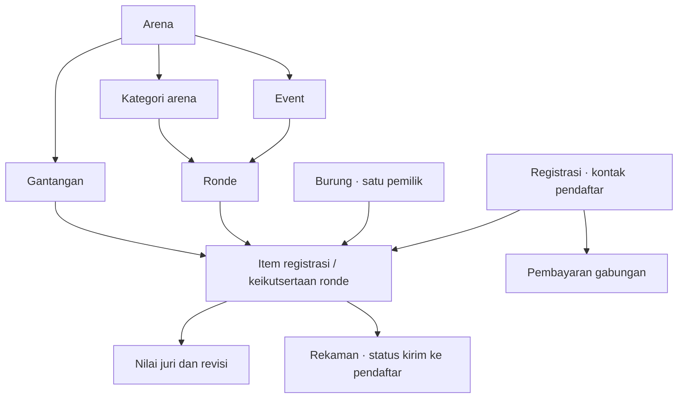
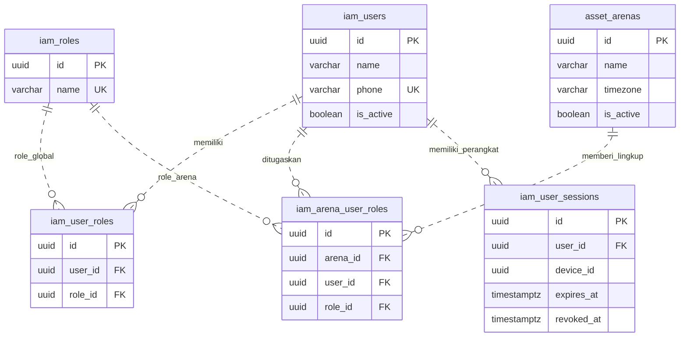
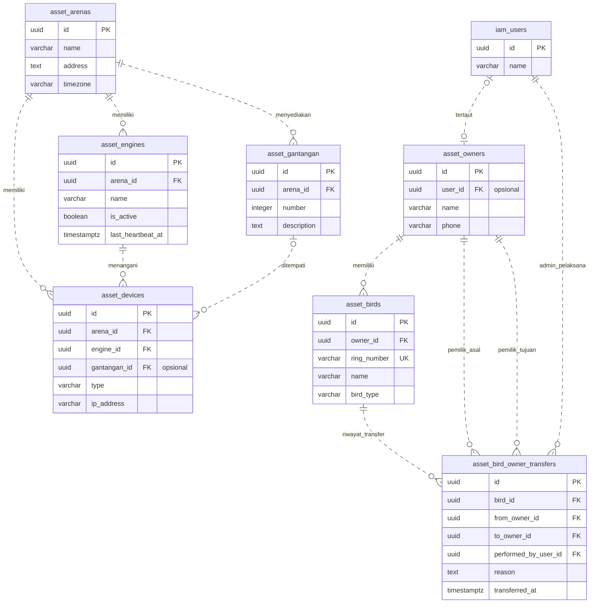
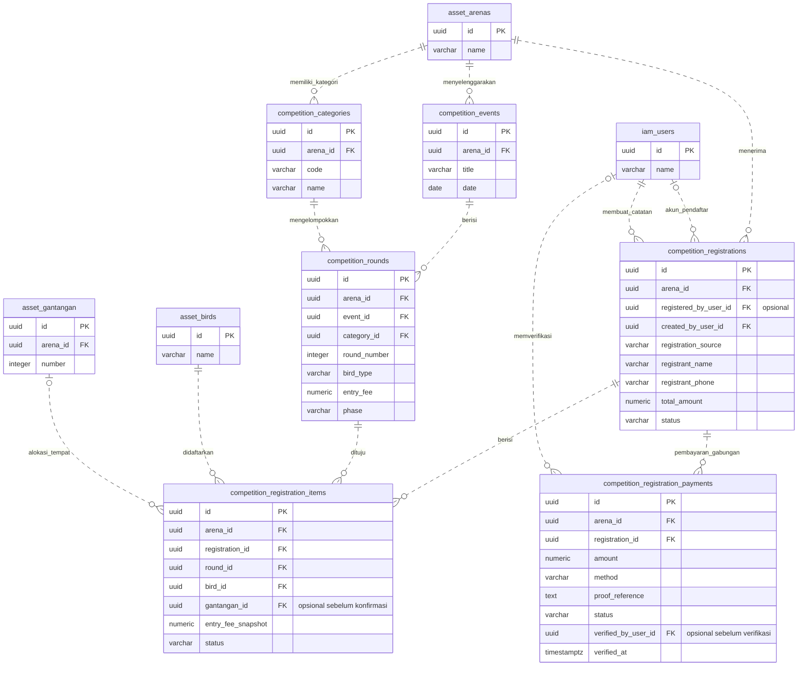
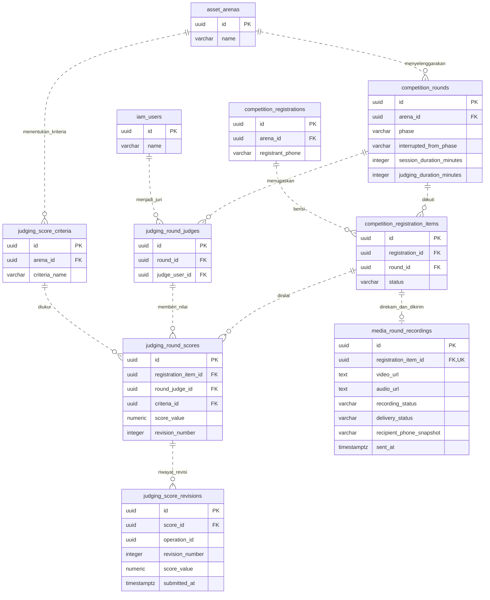

# Rancangan ERD Multi-Arena Kicau Mania

> **Status — DRAFT UNTUK REVIEW**
>
> Tanggal revisi 9 November 2026. Diagram ini menggambarkan usulan skema berdasarkan diskusi terbaru dan jawaban lanjutan. Penerapan ke database menunggu persetujuan atas rancangan ini.

Acuan bisnis berasal dari catatan diskusi. Nama entitas seperti `asset_arenas` dalam diagram mewakili tabel `asset.arenas`. Atribut yang ditampilkan dipilih untuk menjelaskan hubungan dan aturan bisnis. [Catatan diskusi](../../discussion_11062026_erd.txt)

## 1. Gambaran utama

Setiap item registrasi menyatakan satu burung mengikuti satu ronde. Status dan gantangan pada item tersebut menunjukkan apakah keikutsertaan sudah dikonfirmasi. Satu header registrasi menampung beberapa item dan pembayaran gabungannya.

**Penyederhanaan untuk review**

- Satu item registrasi menyimpan burung, ronde, gantangan, dan status keikutsertaan.
- Penugasan juri ronde langsung menunjuk akun juri.
- Satu daftar kriteria arena dipakai bersama untuk seluruh ronde. Ini asumsi sementara untuk kamu tinjau. Daftar dan arti kriteria dikunci setelah mulai digunakan untuk penilaian.
- Status serta tujuan pengiriman video berada pada rekaman.
- Ronde menyimpan fase saat ini. History revisi nilai dan transfer pemilik tetap ditampilkan karena keduanya sudah menjadi kebutuhan yang disepakati.

| Aturan lintas arena | Bentuk hubungan yang diusulkan |
| --- | --- |
| Banyak arena berjalan bersamaan | Event, registrasi, gantangan, dan engine memiliki `arena_id`. |
| Nomor gantangan dapat sama di arena berbeda | Unik pada pasangan `(arena_id, number)`. |
| Kategori dikelola per arena | Admin arena membuat kategorinya sendiri. Kode kategori unik pada pasangan `(arena_id, code)`. |
| Satu registrasi untuk satu arena | Item registrasi, ronde, dan gantangan harus berada pada arena header registrasi. |
| Satu ronde aktif per arena | Ronde berjalan atau terinterupsi membatasi arena terkait. Arena lain dapat menjalankan rondenya. |
| Akun dapat bertugas di beberapa arena | Penugasan role menghubungkan akun, role, dan arena. |
| Burung/pemilik dipakai lintas arena | Master burung dan pemilik bersifat global. Riwayat keikutsertaan berada pada item registrasi. |

## 2. Akun, role, dan perangkat

Akun mempunyai role global melalui `iam.user_roles` dan penugasan operasional melalui `iam.arena_user_roles`. Superadmin mengelola lintas arena. Operator, admin arena, dan juri memperoleh akses melalui penugasan arena.

- Pasangan akun–role global dan kombinasi akun–arena–role operasional harus unik.
- Maksimal tiga perangkat/browser aktif dihitung per akun secara keseluruhan. Login ulang pada perangkat yang sama memakai slot yang sama. Perangkat keempat ditolak.
- Penugasan sebagai juri arena perlu dilanjutkan dengan penugasan pada ronde, yang terlihat pada diagram penjurian.

## 3. Arena, perangkat, burung, dan pemilik

Setiap arena mengelola gantangan dan engine media. Fase awal menggunakan satu engine media aktif per arena. Setiap burung wajib menunjuk tepat satu pemilik. Seorang pemilik dapat memiliki beberapa burung dan dapat ditautkan ke akun cloud.

- Tautan akun pada master pemilik opsional dan unik jika terisi. Pemilik tanpa akun tetap dapat tercatat.
- Transfer dilakukan admin dengan alasan dan history. Pemilik aktif disimpan pada `asset.birds.owner_id`.
- Burung yang pernah mengikuti lomba tetap mempunyai riwayat peserta meskipun pemiliknya kemudian berubah.
- Perangkat boleh belum ditempatkan pada gantangan. Arena engine, perangkat, dan gantangan yang ditautkan harus sesuai.

## 4. Registrasi, pembayaran, dan keikutsertaan

Pendaftaran manual menyimpan nama dan kontak pendaftar dengan akun opsional. Pendaftaran online memakai akun login. Satu header registrasi membayar beberapa item burung/ronde dalam satu arena. Tarif per item disimpan sebagai snapshot saat pendaftaran.

- Header dapat berstatus draft ketika belum mempunyai item atau pembayaran. Item berstatus menunggu pembayaran sampai pembayaran gabungan diverifikasi dan seluruh alokasi berhasil. Item terkonfirmasi menyimpan gantangan yang wajib terisi.
- Metode pembayaran awal adalah tunai atau transfer dengan verifikasi operator/admin. Satu pembayaran berlaku untuk header beserta itemnya. Tabel pembayaran dapat menyimpan beberapa percobaan dengan satu pembayaran gabungan yang diverifikasi untuk konfirmasi.
- Pendaftar tanpa akun disimpan pada snapshot nama dan kontak. `created_by_user_id` menunjuk operator untuk input manual atau akun pendaftar untuk input online.
- Kontak pendaftar menjadi penerima video. Transfer pemilik burung tidak mengubah snapshot registrasi.
- Untuk item aktif, satu burung hanya memiliki satu keikutsertaan pada ronde yang sama. Gantangan yang sudah dialokasikan hanya dapat dipakai satu item aktif per ronde. Item yang dibatalkan melepas alokasi. Arena header, item, ronde, serta gantangan harus sama.
- Kategori dimiliki arena melalui `competition.categories.arena_id`. Admin hanya mengelola kategori pada arena tempat ia ditugaskan. Arena berbeda boleh memiliki kode kategori yang sama, misalnya `VIP`, dengan keunikan `(arena_id, code)`.
- Kategori ronde harus berasal dari arena ronde tersebut. Rancangan SQL memakai FK gabungan `competition.rounds(category_id, arena_id)` ke `competition.categories(id, arena_id)`, dengan constraint unik pendukung `(id, arena_id)` pada kategori.

## 5. Penjurian, revisi nilai, dan media

Setiap ronde memiliki daftar juri yang ditugaskan langsung melalui `judge_user_id`. Kriteria dibaca dari daftar arena. Item registrasi berstatus terkonfirmasi menjadi peserta yang dinilai dan direkam.

| Aturan | Makna pada rancangan |
| --- | --- |
| Juri | Pasangan `(round_id, judge_user_id)` unik. Akun harus memiliki penugasan juri pada arena ronde. Daftar juri dikunci saat ronde dimulai. |
| Kriteria | Satu daftar kriteria per arena untuk seluruh ronde. Keunikan nama berlaku per arena. Asumsi review ini membatasi perubahan daftar dan arti kriteria setelah mulai dipakai. |
| Fase ronde | `PREPARED → RUNNING → JUDGING → CLOSED`, dengan `INTERRUPTED` dan `CANCELLED`. Operator mengendalikan perpindahan fase. |
| Waktu penilaian | Submit dan revisi diterima pada fase `JUDGING` untuk item terkonfirmasi. |
| Kelengkapan | Seluruh item terkonfirmasi, juri yang ditugaskan, dan kriteria arena harus sudah dinilai sebelum penutupan. |
| Nilai | Satu skor berlaku per kombinasi item–juri ronde–kriteria. Nilai bulat 1–10 dan berbobot sama. Skor terkini dan history revisi diperbarui bersama. |
| Konsistensi | Item dan juri pada skor harus berasal dari ronde yang sama. Kriteria harus berasal dari arena ronde tersebut. |
| Pengiriman ulang | ID operasi mengidentifikasi kiriman yang diulang. Nomor revisi membantu memeriksa konflik perubahan. |
| Konektivitas | Cloud menjadi sumber nilai resmi. Gangguan koneksi engine menginterupsi arena terkait dan resume dilakukan operator. |
| Media | Engine/worker sistem menulis metadata rekaman dan status pengiriman. Rekaman terhubung ke item registrasi. |
| Penerima | Worker menyalin kontak pendaftar dari header registrasi ke `recipient_phone_snapshot` pada rekaman saat menyiapkan pengiriman. |
| Jadwal | Durasi 10 menit lomba, 15 menit penjurian, jeda siang, dan batas pukul 17 menjadi panduan operator. |

Contoh satu ronde dengan 24 item terkonfirmasi, 2 juri, dan 3 kriteria membutuhkan **144 nilai kriteria**. Item registrasi sudah menyediakan daftar peserta, sedangkan `round_judges` menyediakan daftar juri yang bertugas.

## Cara membaca relasi

Pada diagram ER, `||` berarti tepat satu, `|o` atau `o|` berarti nol atau satu, dan `o{` berarti nol atau banyak. FK opsional dapat kosong, seperti akun pemilik, akun pendaftar manual, dan gantangan sebelum item dikonfirmasi.

Lingkup arena diperoleh melalui event/ronde, registrasi, dan master aset. `arena_id` ditampilkan pada titik lingkup utama. Pada tahap SQL, kombinasi relasi perlu menjamin bahwa kategori, item registrasi, gantangan, juri, dan kriteria saling sesuai. Batas tiga perangkat berlaku global per akun.

## Ringkasan penyederhanaan

| Bagian | Rancangan untuk review |
| --- | --- |
| Peserta ronde | Item registrasi menyimpan status serta gantangan dan langsung dipakai skor/rekaman. |
| Penugasan juri | `round_judges` menunjuk `users` melalui `judge_user_id`. |
| Kriteria | Daftar per arena dipakai seluruh ronde dan dikunci setelah mulai digunakan. |
| Pengiriman video | Status kirim, tujuan, dan waktu kirim disimpan pada rekaman. |
| Fase ronde | Fase sekarang dan fase asal interupsi disimpan pada ronde. |
| Revisi nilai | Skor berlaku mempunyai history revisi. |
| Transfer pemilik | Pemilik aktif disimpan pada burung dengan history transfer admin. |

Rancangan tetap memuat multi-arena, kategori buatan admin arena, registrasi multi-item, pembayaran gabungan, serta pendaftar manual dengan akun opsional. Tabel pendukung akun seperti auth provider dan paket/langganan membership dapat dilihat pada skema sumber. [Skema sumber saat ini](../../db-dump/full_db.dump)
