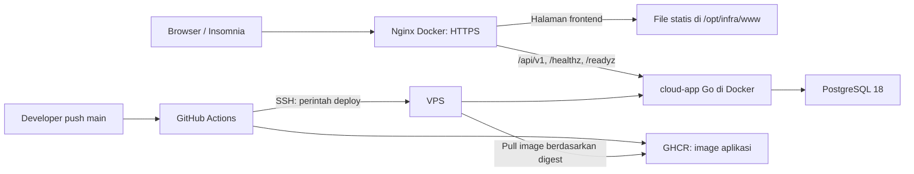

# Belajar deployment Kicau Mania dari VPS yang sekarang

Panduan untuk pemilik/developer proyek yang ingin mengoperasikan server sendiri. Baca konsepnya dahulu, lalu pilih prosedur sesuai pekerjaanmu. Panduan ini membahas **cloud-app**; instalasi engine CCTV lokal adalah pekerjaan terpisah.

Acuan diperiksa pada **10 November 2026**: Nginx Docker, cloud-app, PostgreSQL 18 dan pembaruan sertifikat Docker berjalan. Database dev sudah berisi data mock. Status ini bukan sesuatu yang berlaku selamanya; periksa lagi ketika melakukan perubahan.

**Jalur baca:** bagian 1–4 untuk memahami sistem, bagian 5–7 sebelum mengubah database yang berisi data, bagian 8–10 untuk menangani gangguan. [Runbook operasional](devops_runbook.md) berisi referensi konfigurasi teknis.

## 1. Apa yang sebenarnya berjalan?

Ada dua alur: pengguna mengakses aplikasi, dan developer mengirim versi aplikasi baru.



| Istilah | Arti dalam proyek ini |
| --- | --- |
| VPS | Komputer Linux jarak jauh yang menjalankan layanan. |
| SSH | Cara masuk atau menjalankan perintah pada VPS. |
| Docker image | Paket aplikasi dan lingkungan runtime yang sudah dibangun. |
| Container | Proses yang menjalankan image. Container aplikasi dapat diganti tanpa mengganti database. |
| Docker Compose | Konfigurasi service, jaringan, environment dan penyimpanannya. |
| Nginx | Pintu masuk HTTPS; memilih request menuju frontend atau backend. |
| PostgreSQL | Server database yang menyimpan struktur dan data bisnis. |
| GHCR | Tempat menyimpan image Docker, bukan database. |
| CI | Pemeriksaan dan build otomatis ketika kode berubah. |
| CD | Pengiriman dan pengaktifan versi aplikasi secara otomatis. |
| Commit SHA | Identitas versi kode, misalnya awalan `7509836`. |
| Image digest | Identitas isi image, berbentuk `sha256:...`; dipakai untuk memastikan paket yang dipasang. |

Sertifikat HTTPS mengenkripsi koneksi dan membuktikan identitas domain. Sertifikat bukan akun login aplikasi dan berbeda dari SSH key.

| Kebutuhan | URL |
| --- | --- |
| Situs utama | https://megaallstararena.com/ |
| Frontend dev | https://dev.megaallstararena.com/ |
| API | https://dev.megaallstararena.com/api/v1/ |
| Proses hidup | https://dev.megaallstararena.com/healthz |
| API dan skema database siap | https://dev.megaallstararena.com/readyz |

Contoh: halaman frontend ada di `/`, sedangkan login backend ada di `/api/v1/auth/login`. **Halaman frontend tampil belum membuktikan API sehat.**

## 2. Di mana perintah diketik?

Setiap contoh diberi label. Salin perintahnya saja, tanpa prompt `root@...#` atau `PS C:\...>`.

**Windows — PowerShell:** masuk ke VPS dengan key deployment yang sudah terdaftar.

```powershell
ssh -i "$env:USERPROFILE\.ssh\kicau_deploy" root@187.124.138.204
```

Setelah login, prompt berubah menjadi Linux. Perintah `/opt/...`, `docker` dan `bash` berikut dijalankan di VPS.

**VPS — Bash:** pemeriksaan yang hanya membaca status.

```bash
docker ps --format "table {{.Names}}\t{{.Image}}\t{{.Status}}"
```

```bash
curl --fail --silent --show-error https://dev.megaallstararena.com/readyz
```

Hasil normal: aplikasi/database healthy, Nginx/Certbot berjalan, dan response JSON berisi `success: true` serta `READY`. Jalankan langkah satu per satu dan baca hasilnya. Jika gagal, jangan meneruskan langkah yang membutuhkan keberhasilan langkah tersebut.

## 3. Apa fungsi folder dan file?

### Di repository / komputer developer

| Lokasi | Fungsi |
| --- | --- |
| `cloud-app/internal/`, `cmd/` | Source code backend. |
| `cloud-app/db/migrations/` | Perubahan struktur database yang diberi versi. |
| `cloud-app/db/queries/` | SQL repository aplikasi; perubahan query belum tentu mengubah skema. |
| `cloud-app/db/seeds/` | Data contoh untuk pengujian. |
| `cloud-app/deployment/opt/` | Template konfigurasi VPS; edit template tidak otomatis mengubah semua konfigurasi aktif. |
| `.github/workflows/cloud-app.yml` | Urutan CI/CD. |

### Di VPS

| Lokasi | Fungsi |
| --- | --- |
| `/opt/infra/docker-compose.yml` | Stack Nginx dan Certbot. |
| `/opt/infra/nginx/` | Konfigurasi gateway aktif. |
| `/opt/infra/www/main/`, `www/dev/` | File frontend aktif, terpisah dari image Go. |
| `/opt/infra/certs/` | Akun ACME, sertifikat dan private key TLS; tidak masuk Git. |
| `/opt/infra/acme/` | File pembuktian kepemilikan domain untuk sertifikat. |
| `/opt/infra/acme-work/` | Workdir Certbot dan marker reload sertifikat. |
| `/opt/apps/kicau-mania/app.env` | Konfigurasi aplikasi, termasuk DATABASE_URL dan SMTP/Google. |
| `/opt/apps/kicau-mania/database.env` | Credential administrator PostgreSQL. |
| `/opt/apps/kicau-mania/.env` | Interpolasi Compose, bukan pengganti app.env. |
| `/opt/apps/kicau-mania/config/docker/` | Credential untuk menarik image GHCR privat. |
| `/opt/apps/kicau-mania/data/postgres18/` | **Data database aktual**, bukan cache/build. |
| `/opt/apps/kicau-mania/data/backups/` | Snapshot dump dari script backup. |
| `/opt/apps/kicau-mania/incoming/<commit>/` | Bundle yang dikirim GitHub, termasuk konfigurasi/script/migrasi. |
| `/opt/apps/kicau-mania/releases/` | Snapshot konfigurasi dan image setiap percobaan deploy; dapat mengandung rahasia app.env. |
| `/opt/apps/kicau-mania/state/current` | Symlink ke rilis terakhir yang lolos readiness. |
| `state/deployments.log` | Riwayat berhasil/gagal/rollback deployment. |
| `state/migrations.log` | Catatan migrasi dan checksum; bukan runner yang mencegah pengulangan otomatis. |
| `state/deploy.lock` | Pengunci pekerjaan deploy/database. File ada tidak berarti lock sedang dipegang. |
| `/opt/scripts/` | Script operasional. |

`/opt/containerd` bukan bagian cloud-app. Saat diperiksa hanya berisi direktori kosong; executable containerd aktif ada di `/usr/bin/containerd`. Tidak perlu dikelola untuk deployment harian.

Simpan incoming/rilis aktif dan kandidat rollback. Rollback otomatis memakai releases; redeploy manual versi lama juga membutuhkan incoming commit tersebut. Jangan menghapus semuanya hanya karena deployment terakhir hijau.

## 4. Apa yang otomatis dan apa yang manual?

| Perubahan | Tindakan |
| --- | --- |
| Logika Go tanpa perubahan skema | Review dan push/merge main; CI/CD mengganti aplikasi. |
| Query tanpa perubahan struktur yang diperlukan | Ikut build/deploy backend karena SQL di-embed. |
| Tabel, kolom, index, view, constraint | Buat migrasi baru; jalankan manual dengan prosedur bagian 6. |
| Registrasi, peserta, nilai | Melalui API/usecase, bukan deployment. |
| Data mock | Seed eksplisit pada database pengujian. |
| app.env | Edit di VPS, lalu deploy ulang agar container memakai konfigurasi baru. |
| Halaman frontend | Perbarui `/opt/infra/www/...`; pipeline backend belum membangun frontend ini. |
| Nginx/Compose gateway | Terapkan manual; deploy backend tidak mengubah gateway. |
| Sertifikat | Certbot Docker memperbarui otomatis setelah setup benar. |
| Major version PostgreSQL | Prosedur upgrade database tersendiri. |

Alurnya: **push main → verify → image → deploy → readiness internal + HTTPS → current**. Verify berisi build/vet, pemeriksaan konfigurasi dan simulasi container. Suite tes Go tidak dijalankan otomatis pada konfigurasi sekarang.

PostgreSQL, migrasi dan seed tidak otomatis diulang. Job hijau membuktikan pemeriksaan yang tersedia serta deployment lolos; bukan seluruh alur bisnis, browser, SMTP/Google atau CCTV sudah benar.

## 5. Rutinitas deploy kode tanpa perubahan skema

1. Ubah kode dan review diff pada komputer developer.
2. Jalankan pemeriksaan relevan dan uji perilaku yang berubah.
3. Push/merge main ketika siap dideploy; perubahan cloud-app pada main memicu pipeline.
4. Buka GitHub → Actions → Cloud-app CI/CD. Baca langkah pertama yang gagal bila ada.
5. Sesudah hijau, cek readiness dan satu alur API terkait perubahan.

**Windows — PowerShell, dari cloud-app:**

```powershell
go build ./...
go vet ./...
```

**VPS — Bash, sesudah deploy:**

```bash
curl --fail --silent --show-error https://dev.megaallstararena.com/readyz
```

```bash
readlink -f /opt/apps/kicau-mania/state/current
```

```bash
tail -n 10 /opt/apps/kicau-mania/state/deployments.log
```

Cocokkan commit aktif dengan commit yang kamu kirim. Tidak perlu git pull/build Go di VPS. Bug kode aplikasi tidak diselesaikan dengan reset database.

## 6. Kalau database sudah berisi data, bagaimana mengubahnya?

Contoh: peserta membutuhkan kolom tambahan. **Tambahkan migrasi baru**, bukan mengedit migrasi 001–007 yang pernah diterapkan. Struktur tabel dapat diubah sambil mempertahankan baris, tetapi keselamatan data tetap bergantung pada isi SQL.

### Urutan untuk perubahan tambahan yang kompatibel

1. Siapkan kode dan migrasi pada branch/PR; belum merge main.
2. Uji migrasi pada database sementara dengan data representatif. Lindungi salinan data nyata.
3. Pastikan kode lama tetap dapat berjalan setelah migrasi, misalnya kolom baru nullable/default sesuai.
4. Jadwalkan maintenance, upload SQL dan ambil backup.
5. Hentikan app, jalankan tepat satu migrasi baru dan periksa hasilnya.
6. Jika sukses serta kompatibel, hidupkan kembali kode lama dan cek readiness.
7. Baru merge kode baru ke main agar CI/CD memasang aplikasi yang memakai skema baru.

**Mengapa bukan langsung push main?** Pipeline bisa memasang kode yang membutuhkan kolom baru sebelum kolom dibuat. PR memberi waktu menyiapkan skema sebelum deployment dipicu.

### Contoh perintah

`008_nama_perubahan.up.sql` adalah **placeholder**, ganti dengan file nyata yang sudah direview. Jangan membuat file kosong untuk mengikuti contoh.

**VPS — Bash:**

```bash
mkdir -p /opt/apps/kicau-mania/database/migrations
```

```bash
tail -n 10 /opt/apps/kicau-mania/state/migrations.log
```

**Windows — PowerShell:**

```powershell
scp -i "$env:USERPROFILE\.ssh\kicau_deploy" "D:\Workdir\Go\kicau-mania\cloud-app\db\migrations\008_nama_perubahan.up.sql" root@187.124.138.204:/opt/apps/kicau-mania/database/migrations/
```

**VPS — Bash:** buat backup. Pastikan berhasil dan catat nama file.

```bash
bash /opt/scripts/db/backup-db.sh
```

Simpan snapshot penting keluar VPS; retensi backup rutin bukan penyimpanan selamanya. Lalu hentikan API dan terapkan migrasi:

```bash
docker stop -t 20 kicau_mania_app
```

```bash
bash /opt/scripts/db/migrate.sh /opt/apps/kicau-mania/database/migrations/008_nama_perubahan.up.sql
```

Script saat ini selalu mensyaratkan app berhenti. Ia menggunakan `psql -1 -f -` dan ON_ERROR_STOP: file yang mendukung transaksi commit seluruhnya atau dibatalkan saat gagal. Jangan menaruh COMMIT/BEGIN sendiri untuk mengakali wrapper. CREATE INDEX CONCURRENTLY, misalnya, memerlukan prosedur terpisah karena tidak bisa berada dalam transaksi biasa.

**Jika sukses dan skema masih cocok dengan kode lama:**

```bash
docker start kicau_mania_app
```

```bash
curl --fail --silent --show-error https://dev.megaallstararena.com/readyz
```

Setelah itu merge PR kode baru dan periksa lagi fitur terkait.

**Jika gagal:** jangan lanjut ke file berikutnya atau langsung menjalankan down.sql. Baca error dan pastikan rollback transaksi terjadi. Jalankan kode lama kembali hanya bila skema masih cocok. Perbaiki di lingkungan pengujian dahulu. Script tidak mencegah kamu menjalankan versi sama dua kali.

### Jika perubahan tidak kompatibel

Langsung mengganti nama kolom yang masih dibaca kode lama membuat rollback image lama tidak berfungsi. Pecah perubahan: tambahkan kolom baru → deploy kode yang mendukung peralihan → pindahkan data secara terkendali → hapus kolom lama pada rilis berikutnya setelah tidak diperlukan.

Perubahan tipe, constraint baru dan UPDATE massal juga perlu pemeriksaan data lama. Perubahan besar, backfill banyak baris atau upgrade major PostgreSQL memerlukan rencana sendiri. Reset bukan prosedurnya.

## 7. Backup dan restore ketika data sudah penting

Saat panduan diperiksa, **belum ada jadwal backup database otomatis yang terpasang pada stack ini**. Script tersedia, tetapi adanya full_db.dump lama bukan bukti data hari ini sudah dicadangkan.

Backup manual:

```bash
bash /opt/scripts/db/backup-db.sh
```

Script menulis `.partial`, rename setelah sukses, lalu menjalankan retensi pada file `backup_kicau_mania_*.dump` berumur lebih dari tujuh hari. Catat file hasil `Backup ready:` dan tentukan snapshot yang perlu disimpan lebih lama secara terpisah.

Dump menyimpan satu database, bukan seluruh role/password cluster. Credential dan konfigurasi server juga perlu dilindungi. [Dokumentasi pg_dump](https://www.postgresql.org/docs/18/app-pgdump.html)

**Windows — PowerShell:** contoh mengambil satu file yang sudah dipilih; ganti nama file sesuai hasil backup.

```powershell
New-Item -ItemType Directory -Force .\backup-kicau | Out-Null
scp -i "$env:USERPROFILE\.ssh\kicau_deploy" root@187.124.138.204:/opt/apps/kicau-mania/data/backups/NAMA_FILE_BACKUP.dump .\backup-kicau\
```

Backup dapat memuat data pribadi. Simpan privat, bukan di Git atau folder frontend publik. Salinan pada disk VPS yang sama tidak melindungi dari kehilangan seluruh VPS.

Sebelum menerima data operasional, tentukan seberapa banyak data boleh hilang dan berapa lama pemulihan boleh berlangsung. Backup sekali sehari berisiko kehilangan perubahan sejak snapshot terakhir. Produksi perlu backup otomatis, salinan luar VPS, pemantauan kegagalan dan uji restore. Kebutuhan pemulihan lebih rinci bisa memerlukan base backup dan arsip WAL/PITR; script dump sekarang bukan keseluruhan strategi backup produksi.

### Restore benar-benar mengganti data aktif

Contoh berikut **bukan latihan pada database aktif**:

```bash
bash /opt/scripts/db/restore-db.sh /opt/apps/kicau-mania/data/backups/NAMA_FILE_BACKUP.dump --replace
```

Script membuat backup dahulu, restore ke staging, lalu menghentikan app dan menukar database setelah staging berhasil. App tetap berhenti sesudahnya. Cocokkan skema dan image sebelum menjalankan app kembali. Data yang masuk setelah snapshot tidak ikut dipulihkan oleh snapshot itu.

Cluster baru juga memerlukan role grup yang dirujuk dump dan akun service. Sesudah restore, tinjau catatan migrasi: log file bisa lebih baru daripada isi snapshot. Uji pemulihan di database/container sementara sebelum mengandalkannya saat gangguan nyata.

## 8. Deployment gagal: diagnosis dan rollback

| Gejala | Pemeriksaan awal |
| --- | --- |
| Verify gagal | Baca pemeriksaan kode/config yang gagal; versi baru belum dideploy. |
| Image gagal | Baca log build atau permission registry. |
| Private key/libcrypto | Periksa format VPS_SSH_KEY lengkap dan passphrase. |
| Permission denied (publickey) | Key/user SSH tidak cocok dengan server. |
| GHCR unauthorized | Login registry, izin package atau masa berlaku PAT. |
| Complete VPS environment setup first | .env/app.env/database.env belum tersedia. |
| healthz 200, readyz 503 | HTTP hidup, koneksi/skema database belum siap. |
| HTTPS 502 | Nginx tidak dapat menghubungi upstream. |
| HTTPS 503 | Periksa body/log: readiness atau konfigurasi gateway. |
| API mengembalikan HTML | Request masuk fallback frontend; periksa proxy /api/. |
| API 401/403/409 | Periksa auth, scope/origin atau aturan state/versi; belum tentu masalah deployment. |

**VPS — Bash:** jalankan pemeriksaan berikut satu per satu.

```bash
curl --silent --show-error https://dev.megaallstararena.com/healthz
curl --silent --show-error https://dev.megaallstararena.com/readyz
docker ps --format "table {{.Names}}\t{{.Status}}"
docker logs --tail 100 kicau_mania_app
docker logs --tail 100 kicau_mania_db
docker logs --tail 100 global_reverse_proxy
```

Sensor informasi sensitif sebelum membagikan log. Jangan membagikan isi app.env/database.env, private key atau config Docker.

### Rollback aplikasi berbeda dari restore database

Jika app baru gagal readiness setelah pergantian dimulai, script mencoba mengaktifkan image/config rilis sebelumnya. Job tetap gagal supaya gangguan terlihat. Deployment pertama tidak mempunyai rilis sebelumnya.

Jika bug bisnis terjadi tetapi readyz tetap 200, rollback tidak otomatis dipicu. Perbaiki kode atau redeploy image lama yang masih kompatibel dengan database sekarang.

**VPS — Bash:** contoh redeploy kode lama. Pilih rilis yang sebelumnya diketahui baik; ganti NAMA_FOLDER_RILIS dan pastikan tidak ada maintenance lain yang kamu jadwalkan.

```bash
TARGET=/opt/apps/kicau-mania/releases/NAMA_FOLDER_RILIS
COMMIT=$(cat "$TARGET/COMMIT")
IMAGE=$(sed -n 's/^APP_IMAGE=//p' "$TARGET/image.env")
BUNDLE="/opt/apps/kicau-mania/incoming/$COMMIT"
bash /opt/scripts/app/deploy.sh "$BUNDLE" "$IMAGE" "$COMMIT"
```

Helper ini memasang image lama sebagai rilis baru dengan **app.env saat ini**. Itu berbeda dari rollback otomatis yang memakai snapshot konfigurasi sebelumnya. Keduanya tidak mengembalikan data atau menjalankan down.sql. Periksa kompatibilitas kode/skema/config sebelum memilih image lama.

Perbaiki kode di Git juga; jika main tetap berisi bug, push selanjutnya dapat memasangnya lagi. Revert commit kode murni bisa dipakai, tetapi jangan sampai revert commit campuran menghapus riwayat migrasi yang sudah diterapkan.

## 9. Konfigurasi, credential dan HTTPS

### Mengedit environment

Edit konfigurasi aplikasi di app.env, lalu deploy ulang, misalnya rerun workflow terbaru yang sesuai. **docker restart tidak membaca ulang app.env**: container menyimpan environment saat dibuat dari snapshot rilis.

Mengedit POSTGRES_PASSWORD pada database.env juga tidak mengganti password role pada database yang sudah terinisialisasi. Rotasi password memerlukan perubahan role dan konfigurasi koneksi yang terkoordinasi, bukan penghapusan direktori data.

| Credential | Mengizinkan apa? |
| --- | --- |
| SSH private key pada GitHub secret | Runner masuk ke VPS. |
| PAT classic read:packages di config Docker /opt | VPS menarik image privat. |
| Password cloud_service dalam DATABASE_URL | App masuk PostgreSQL. |

Bearer token pengguna dan sertifikat HTTPS berbeda dari ketiga credential tersebut. Untuk memperbarui login registry:

```bash
docker --config /opt/apps/kicau-mania/config/docker login ghcr.io -u bachtiarilham
```

Masukkan PAT pada prompt Password. Catat masa berlakunya secara privat agar kamu dapat merotasinya sebelum deployment gagal.

### Nginx dan sertifikat

Sesudah mengubah file aktif pada /opt/infra/nginx, validasi lalu reload:

```bash
docker exec global_reverse_proxy nginx -t
docker exec global_reverse_proxy nginx -s reload
```

Periksa log dan URL sesudahnya. Master dapat menolak reload meski syntax test lolos, misalnya jika key rate-limit zone diubah dengan nama zone yang sama.

Renewal sertifikat diperiksa tiap 12 jam; marker renewal memicu reload Nginx dalam sekitar 60 detik. Periksa melalui stack Docker:

```bash
export DOCKER_CONFIG=/opt/apps/kicau-mania/config/docker
cd /opt/infra
docker compose --project-name gateway logs --tail 100 certbot-renew
```

Certbot otomatis tidak berarti backup database otomatis. Jangan mengaktifkan kembali Apache atau Certbot OS lama untuk mengatasi masalah stack Docker tanpa meninjau benturan port dan konfigurasi.

## 10. VPS restart, disk penuh, dan persiapan produksi

Service memakai `unless-stopped`: container yang berjalan normal dapat kembali hidup setelah Docker/VPS restart, tetapi container yang sengaja dihentikan perlu diperhatikan tersendiri. Tetap periksa status dan readyz setelah reboot. [Restart policy Docker](https://docs.docker.com/engine/containers/start-containers-automatically/)

Data PostgreSQL berada pada bind mount data/postgres18. Mengganti container app tidak menghapusnya, tetapi menghapus direktori host tersebut menghapus data aktual. [Bind mounts Docker](https://docs.docker.com/engine/storage/bind-mounts/)

Periksa penggunaan disk sebelum memilih pembersihan:

```bash
df -h /opt
docker system df
```

| Operasi | Pengaruh |
| --- | --- |
| Deploy app | Mengganti proses aplikasi; database tetap. |
| docker restart app | Mengulang proses lama; environment tidak dimuat ulang. |
| docker compose down | Menghentikan stack; bukan rutinitas deploy backend. |
| docker compose down -v | Dapat menghapus volume Docker tertentu. Bind mount PG sekarang tidak dihapus flag ini, tetapi stack tetap berhenti. |
| Menghapus data/postgres18 atau menjalankan reset-empty-vps | Menghapus/membangun ulang database; khusus dev yang memang boleh dibuang. |
| Restore snapshot lama | Mengembalikan keadaan snapshot, bukan semua perubahan sesudahnya. |

Pertahankan rilis/image/bundle aktif dan kandidat rollback. Bedakan data database, backup, image dan log sebelum membersihkan disk.

Sebelum data operasional masuk, siapkan:

- Backup berkala, salinan luar VPS, alert kegagalan dan uji restore yang berhasil.
- Pemisahan data/credential dev dan produksi; akun mock berpassword contoh bukan akun produksi.
- Migrasi yang diuji dengan data representatif beserta rencana kompatibilitas/downtime.
- Pemantauan error, readiness, disk, expiry token registry dan renewal sertifikat.
- Integrasi browser nyata untuk login/cookie/CORS/Google/SMTP sesuai fitur yang dipakai.
- Penerimaan CCTV/NVR/LAN tersendiri; CI cloud-app tidak membuktikan local-app siap.

Delapan akun mock, dua arena dan tiga ronde awal pernah dimasukkan manual ke VPS dev. Registrasi/skor dapat berubah saat Insomnia dipakai. Seed ulang tidak mengembalikan ronde CLOSED atau menghapus hasil pengujian. Baca [panduan seed](../db/seeds/README.md) sebelum menjalankannya lagi.

## 11. Latihan untuk menjadi mandiri

1. Tanpa mengubah server, temukan commit aktif, status container dan readyz. Jelaskan mengapa frontend bisa tampil saat API bermasalah.
2. Pada lingkungan pengujian, ubah kode kecil dan cocokkan commit di GitHub dengan rilis aktif.
3. Pada database sementara, buat backup, ubah data dan restore ke database sementara lain. Periksa hasilnya.
4. Uji migrasi berhasil serta migrasi yang sengaja gagal pada lingkungan sementara; pahami transaksi dan lognya.
5. Tentukan lapisan gangguan dari log sebelum memilih restart, deploy ulang, migrasi atau restore.

Kemampuan utamanya bukan menghafal semua command: **menentukan apa yang berubah, apa yang menyimpan data, dan cara membuktikan layanan pulih tanpa menghapus data.**

Referensi lanjut: [runbook](devops_runbook.md), [API](../docs/API.md), [database/migrasi](../db/README.md), dan [pengujian mock](../db/seeds/README.md).
