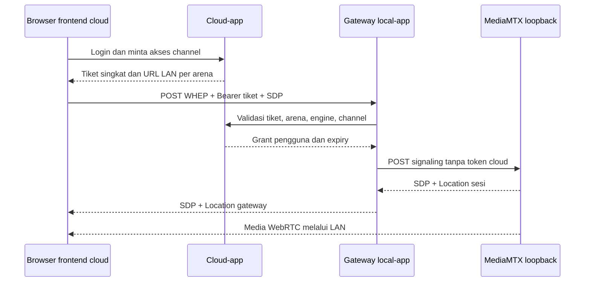

# Alur end-to-end engine media

Panduan belajar khusus beserta jalur baca kode tersedia di [Memahami mediaengine](MEMAHAMI-MEDIAENGINE.md). Dokumen ini merangkum alur integrasi aplikasi secara keseluruhan.

Local-app mengelola media. Cloud-app mengelola pengguna, registrasi, penilaian, dan status perlombaan. Engine tidak menyediakan login juri lokal atau database lomba.

## Startup

`cmd/api/main.go` memuat env → `config/config.go` memvalidasi konfigurasi → `internal/server/server.go` mengunci direktori data/runtime dan membuka listener → `internal/app/container.go` merakit dependency.

Server menjalankan supervisor MediaMTX, modul saving/audio/restream, lalu worker command, heartbeat, dan metadata. `/healthz` menyatakan proses HTTP hidup; `/readyz` memerlukan MediaMTX berjalan, heartbeat segar, dan konfigurasi komunikasi lengkap.

## Live operator/juri melalui LAN

Jalur kode: `internal/delivery/whep/handler.go` membaca request → `internal/cloud/usecase/playback.go` memvalidasi akses melalui cloud → gateway meneruskan signaling ke MediaMTX. Tiket salah scope, kedaluwarsa, atau cloud tidak terjangkau menolak sesi baru. PATCH/DELETE memakai URL sesi rahasia dari WHEP; URL jangan dibagikan.

Cloud memilih engine sesuai arena dan memeriksa penugasan operator/juri. HTTPS, CORS, rute LAN, ICE, firewall UDP, dan izin jaringan lokal browser harus benar. Frontend cloud tidak otomatis membuat LAN terjangkau dari internet.

## Command cloud ke engine

Worker polling → UseCase commands memeriksa arena/engine, expiry, ID/payload → repository menulis JSON command → UseCase operation mengoordinasi saving/restream → repository menyimpan hasil → client melaporkan hasil → journal mencatat acknowledgment.

Command duplikat memakai hasil tersimpan. ID sama dengan payload berbeda ditolak. Command tanpa hasil setelah restart direkonsiliasi melalui manifest; start yang hasilnya tidak pasti tidak dieksekusi ulang secara buta. Cloud perlu command baru jika operator memutuskan retry pekerjaan.

## Rekam, upload, dan metadata

Handler saving → UseCase saving → repository manifest dan service FFmpeg. Sesi menghasilkan MP4 video/audio per channel. Manifest merekam lifecycle, file, serta status upload; setiap penyimpanan menaikkan version.

Worker upload membaca manifest siap upload, memakai adapter S3, dan memperbarui status. Jika S3 belum dikonfigurasi, hasil selesai tetap lokal. Retry mengikuti worker saving yang sudah ada.

Worker metadata membaca manifest → membuat update dengan ID deterministik dan version → repository menyimpan JSON → client mengirim batch → cloud deduplikasi/mengakui ID → repository menandai acknowledged. Local path dan kredensial sumber tidak dikirim. Cloud wajib mengabaikan versi lama setelah versi baru diterapkan.

## Putus koneksi dan restart

Heartbeat default tiap 5 detik melaporkan status media dan jumlah pekerjaan. Cloud terputus membuat engine tidak ready setelah kegagalan/batas heartbeat; rekaman aktif tetap berjalan. Command baru menunggu jaringan pulih, metadata menunggu acknowledgment, dan playback baru ditolak. Sesi WebRTC yang sudah terbentuk mengikuti lifecycle koneksi media.

Shutdown menghentikan HTTP, worker cloud, modul media, lalu supervisor MediaMTX dan melepas lock. Startup berikutnya memakai recovery manifest dan journal command, tanpa SQLite.

Lihat [kontrak cloud](ENGINE-CLOUD-CONTRACT.md) untuk payload dan batas implementasi cloud saat ini, serta [peta kode](PETA-KODE.md) untuk fungsi setiap file.

## Delivery berdasarkan protokol

Gateway WHEP berada di internal/delivery/whep. Handler dan pengelola koneksi WebSocket berada di internal/delivery/websocket; handler meminta subscription melalui interface SubscribeAudio/SubscribeMetrics, lalu transport mengirim frame. Container membuat kedua handler, router HTTP memasang middleware origin/auth yang sesuai, dan shutdown menutup koneksi melalui WebSocket.Close(). Katalog channel REST tetap di delivery/rest/channel.

## Jalur baca domain cloud

- Command: `internal/cloud/worker/scheduler.go` → `usecase/command_polling.go` → `client/command_api.go` → `repository/journal.go` → `usecase/command_execution.go` → UseCase recording/restream.
- Heartbeat: `usecase/heartbeat.go`; hasil acknowledgment memperbarui state Engine pada `connection.go`, lalu readiness dibaca melalui `status.go`.
- Playback: handler WHEP → `usecase/playback.go` → client HTTP cloud → validasi grant di UseCase.
- Metadata: `usecase/recording_metadata.go` → journal → client → acknowledgment. Format hash dan urutan persistensi tidak berubah.

Nama file relatif di atas berada di bawah `internal/cloud`, kecuali handler WHEP dan domain media.
## Membaca alur media

Katalog channel: `delivery/rest/channel` → `mediaengine/channel/usecase` → katalog repository dan interface playback. Identitas tetap berupa Channel tanpa kredensial; hasil playback berupa PlaybackChannel. ChannelResponse adalah DTO HTTP di handler.

Audio: UseCase tetap meminta interface Broadcaster/MetricSender; container memasang implementasi dari `mediaengine/audio/service`. Worker capture, retry, dan antrean metrik tetap berjalan seperti sebelumnya.

Recording berada dalam satu package `mediaengine/saving/usecase`: `saving.go` untuk state/startup/shutdown, `session.go` untuk lifecycle sesi, `query.go` untuk daftar/pencarian, `recovery.go` untuk startup recovery, `upload.go` untuk upload/retry, dan `limits.go` untuk kapasitas/durasi. Seluruh file memakai instance serta mutex yang sama.
