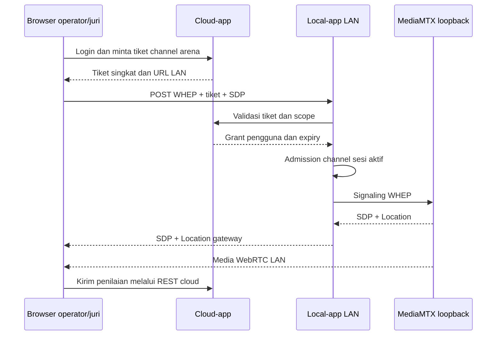

# Alur end-to-end engine media

Panduan rinci: [Memahami mediaengine](MEMAHAMI-MEDIAENGINE.md). Local-app hanya mengelola media. Login, registrasi, nilai dan status perlombaan tetap menjadi tanggung jawab cloud.

## Startup

`cmd/api/main.go` → konfigurasi env → server mengunci DATA_DIR/RUNTIME_DIR → app merakit dependency → supervisor MediaMTX dan worker audio/upload/restream disiapkan → recovery sesi → worker komunikasi cloud → HTTP server.

Tidak ada capture audio atau recording otomatis. MediaMTX menggunakan sumber on-demand. Journal nonterminal dari boot sebelumnya ditandai INTERRUPTED, segmen diperiksa/finalisasi, dan media tidak dilanjutkan otomatis. `/healthz` menyatakan proses HTTP hidup; `/readyz` memeriksa MediaMTX dan komunikasi cloud, bukan keberhasilan semua kamera.

## Mulai media

Operator memanggil POST `/api/v1/media/sessions` dengan id, channels, dan restreams opsional. Jalur baca: [model](internal/mediaengine/session/model/session.go) → [handler](internal/delivery/rest/session/handler.go) → [UseCase](internal/mediaengine/session/usecase/session.go) → [journal](internal/mediaengine/session/repository/journal.go).

UseCase memvalidasi pilihan dan disk, menolak sesi aktif lain, menyimpan journal, lalu mereservasi manifest per channel. Setelah diterima dengan 202, worker sesi menjalankan pipeline per channel dan guard. Satu FFmpeg menghasilkan segmen fMP4 A/V dan PCM; analyzer/broadcaster menerima PCM. Restream yang dipilih memakai adapter tersendiri.

Channel gagal dicoba lagi setiap 5 detik dengan segmen baru. Channel lain tetap berjalan. Status GET `/api/v1/media/sessions/:id` memperlihatkan RUNNING/DEGRADED, status channel dan hasil finalisasi.

## Live dari frontend cloud

Frontend tidak perlu dipisah. Request nilai menuju cloud, sedangkan playback menuju engine sesuai arena. Cloud tidak membawa byte video. Channel di luar sesi aktif menolak playback/subscription baru. Cloud mati menolak playback baru tetapi tidak menghentikan recording aktif. Endpoint pendamping cloud masih belum aktif. HTTPS, CORS, ICE, izin LAN browser dan firewall harus diverifikasi pada arena.

## Stop dan hasil

POST `/api/v1/media/sessions/:id/stop` → 202 STOPPING → tutup admission/retry/audio → drain POST WHEP yang telah diterima → tutup WHEP/WebSocket → hentikan restream dan pipeline → FINALIZING → validasi/concat segmen → READY atau FAILED per recording → STOPPED.

Kegagalan menutup playback upstream memicu restart MediaMTX; Stop tidak selesai selama teardown belum dipastikan. FFmpeg dihentikan graceful dengan `q` sebelum batas kill. Finalisasi menggunakan stream-copy dan commit sementara/flush/rename. Gangguan disimpan, celah dilewati. Codec antarsegmen tidak cocok membuat finalisasi gagal dan sumber dipertahankan.

Uploader tetap hidup setelah Stop. Manifest READY → upload S3 → UPLOADED atau retry persisten. Metadata hasil dikirim worker cloud sampai acknowledged. ID/object key lama tidak berubah; field segments/gaps/error bersifat opsional.

## Command cloud

Scheduler polling → UseCase memeriksa scope/expiry/deduplikasi → journal command → CommandExecutor memanggil UseCase sesi → hasil diterima disimpan → report cloud → acknowledgment journal.

Jenis command: `media.session.start` dengan payload Mulai; `media.session.stop` dengan `{ "id": "session-001" }`. Command lama ditolak. Setelah restart, start tidak dieksekusi ulang secara buta; sesi INTERRUPTED memerlukan keputusan operator dan ID sesi baru. Endpoint cloud, ERD dan SQL bisnis tidak diimplementasikan di sini.

## Penerimaan

[Skenario penerimaan media](SESSION-ACCEPTANCE.md) mencakup start/stop, channel gagal, PCM lambat, restream, race playback, restart, finalisasi, disk dan upload. Suite tes tidak dijalankan otomatis.
