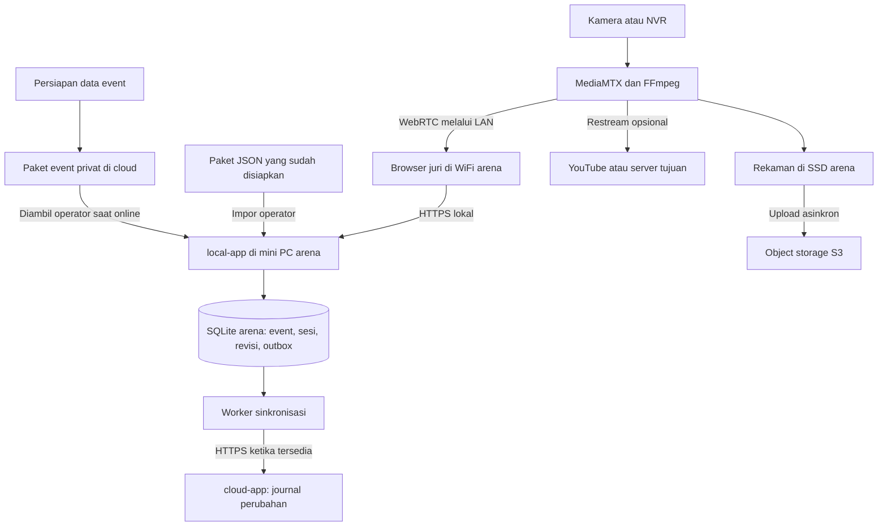
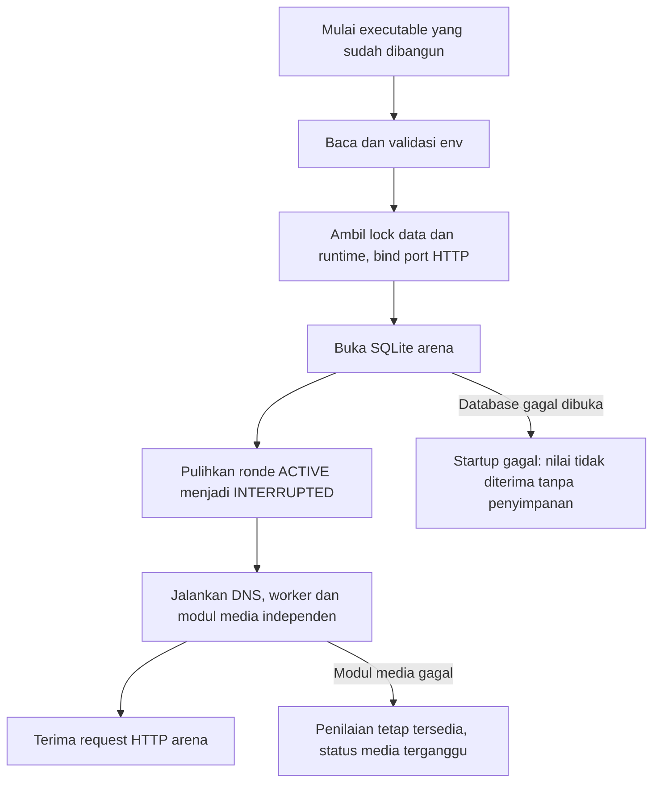
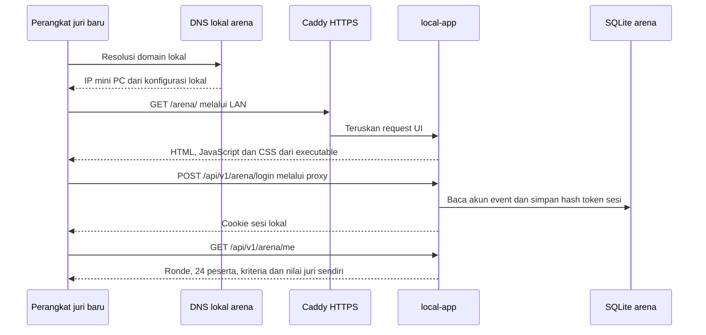
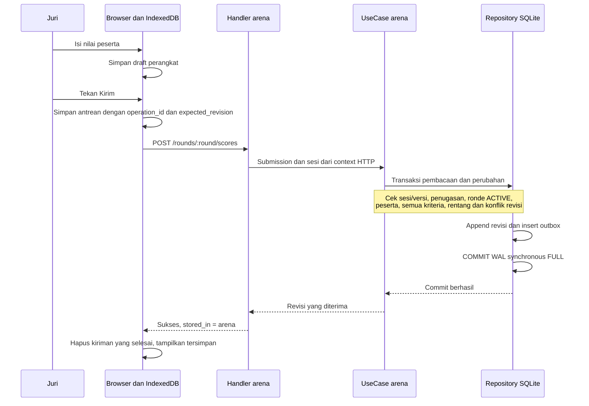
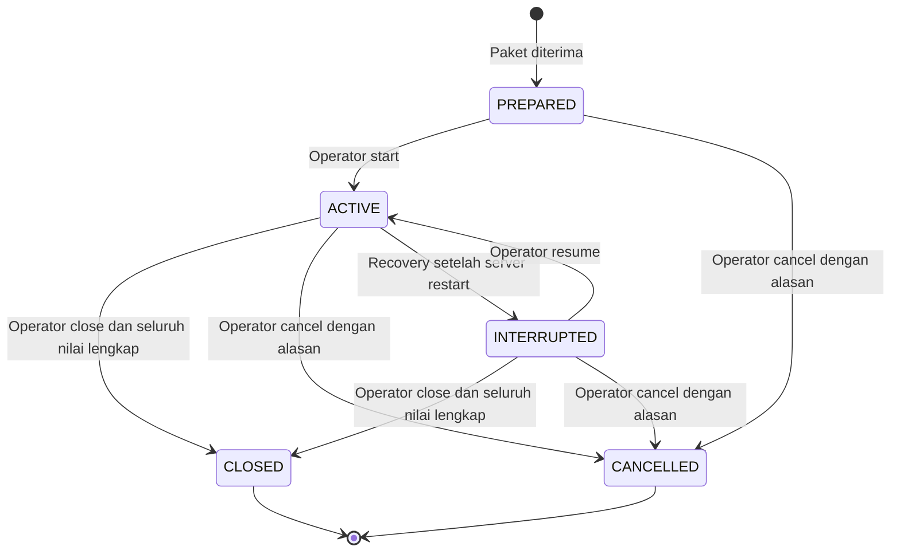
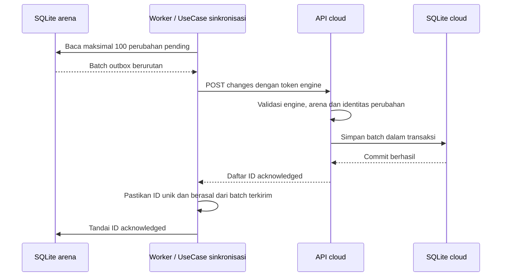
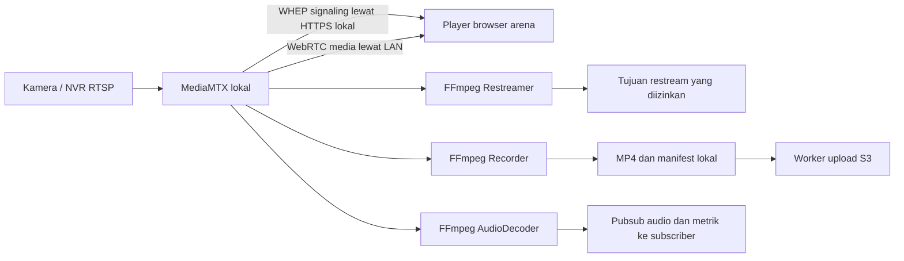

# Alur logic end-to-end arena

Dokumen ini menjelaskan perjalanan event dari persiapan, akses juri, penyimpanan nilai, rekap, media, hingga sinkronisasi dan pemulihan. Alur mengikuti implementasi `local-app` dan `cloud-app` saat ini. Panduan perintah instalasi dan konfigurasi ada di [OFFLINE-FIRST.md](OFFLINE-FIRST.md).

## 1. Gambaran keseluruhan

**Selama lomba, server arena adalah sumber nilai resmi.** Browser juri selalu mengakses aplikasi lokal melalui WiFi arena. Cloud menerima salinan perubahan secara asinkron; penyimpanan nilai tidak menunggu cloud, kamera, restream, atau upload rekaman.



| Komponen | Tanggung jawab | Ketergantungan internet saat lomba |
| --- | --- | --- |
| Frontend lokal `/arena/` | Login event, input nilai, draft perangkat, tampilan operator dan live | Tidak, dilayani mini PC |
| UseCase arena | Aturan event, autentikasi juri, revisi, transisi ronde, rekap | Tidak |
| SQLite arena | Nilai resmi, history, sesi, audit, antrean sinkronisasi | Tidak |
| MediaMTX / FFmpeg | Live LAN, audio, rekaman, restream | Live LAN dan rekaman tidak; tujuan restream bergantung jaringan tujuan |
| Worker sinkronisasi | Mengirim perubahan dan mengambil perintah media | Ya untuk menghubungi cloud; kegagalannya tidak memblokir nilai |
| Cloud exchange | Menyimpan paket, journal perubahan, perintah dan hasilnya | Diperlukan hanya untuk komunikasi cloud |

Pendaftaran, CRUD peserta, penyusunan paket dari database bisnis, dan website publik cloud adalah alur lanjutan yang belum dibuat. Saat ini cloud exchange dapat menerima paket yang sudah disiapkan, lalu menyediakannya untuk engine tujuan. Rekap publik otomatis dari journal cloud juga belum tersedia.

## 2. Identitas dan otoritas data

| Identitas / kredensial | Digunakan untuk |
| --- | --- |
| `ARENA_ID` | Identitas lokasi arena |
| `ENGINE_ID` | Identitas instance engine yang menerima paket/perintah |
| ID event dan versi paket | Memastikan roster, peserta, dan kriteria berasal dari snapshot yang sesuai |
| Akun username/password khusus event | Login juri ke arena, termasuk saat offline |
| Cookie `arena_session` | Sesi juri lokal; token acak, hash disimpan di database |
| `API_TOKEN` | Akses operator ke API lokal |
| `CLOUD_ENGINE_TOKEN` | Autentikasi mesin arena ke cloud |
| `CLOUD_ADMIN_TOKEN` | Unggah paket dan antrekan perintah melalui API operator cloud |
| `HOSTINGER_API_TOKEN` | DNS-01 untuk sertifikat proxy HTTPS, bukan autentikasi bisnis |

Password akun cloud tidak diperlukan untuk login juri lokal. Paket membawa hash bcrypt password event; browser tidak menerima daftar hash/password juri. Juri hanya melihat nilai miliknya, sementara operator dapat melihat rekap seluruh juri.

## 3. Persiapan sebelum event

1. Data event disiapkan: peserta, penempatan lapak, kriteria, ronde, serta akun dan penugasan juri.
2. Data dibekukan menjadi paket JSON dengan ID event, versi, `arena_id`, dan `engine_id` tujuan.
3. Paket privat diunggah ke cloud exchange melalui `POST /api/v1/operator/packages`, atau disediakan sebagai file untuk impor lokal.
4. Operator arena memilih **ambil paket cloud** atau **impor file**. Pengambilan cloud adalah aksi eksplisit, bukan syarat startup atau submit nilai.
5. UseCase arena memvalidasi identitas, versi, keunikan peserta/juri/kriteria, hash password, serta tepat 24 lapak per ronde.
6. Daftar juri per ronde ditetapkan. Jika tidak diberikan, seluruh juri pada paket ditugaskan ke ronde tersebut.
7. Paket disimpan ke SQLite bersamaan dengan perubahan `event.prepared` di outbox. Hash password tidak disertakan pada perubahan outbox tersebut.
8. Operator memeriksa login juri, sumber video, domain lokal, sertifikat, kapasitas disk, dan backup sebelum memulai.

Paket identik dapat diimpor ulang tanpa membuat persiapan ganda. Paket berbeda harus memiliki versi lebih tinggi dan hanya bisa mengganti event yang seluruh rondenya belum digunakan. Setelah ronde pernah dimulai atau dibatalkan, roster event tidak dapat diganti lewat impor paket baru. Perubahan versi paket membuat sesi versi lama tidak berlaku.

Generator `cmd/event-package -demo` hanya membuat data sintetis untuk pengujian; generator ini belum merupakan sistem pendaftaran peserta.

## 4. Startup server arena



Startup tidak memanggil cloud untuk mengizinkan operasional. Paket dan akun yang sudah tersimpan langsung dapat digunakan. MediaMTX dicoba kembali ketika berhenti; kegagalan media tidak mematikan HTTP penilaian. DNS yang gagal bind juga tidak mematikan HTTP, tetapi akses melalui domain tetap harus diperbaiki agar perangkat juri dapat menjangkaunya.

Database berada di `DATA_DIR/arena.sqlite`. Konfigurasi MediaMTX hasil render berada di `RUNTIME_DIR/mediamtx.yml`; file runtime tersebut bukan penyimpanan nilai atau rekaman.

## 5. Browser baru mengakses aplikasi ketika internet mati

Contoh alamat cloud adalah `https://dev.megaallstararena.com`. Alamat juri di arena adalah `https://lan-dev.megaallstararena.com`; semua alamat dan IP dapat diubah melalui env.



DNS DHCP perangkat harus mengarah ke resolver arena. Sertifikat HTTPS sudah harus diperoleh dan tersimpan sebelum event, serta masih valid. Akses ini tidak membutuhkan frontend cloud, login cloud, atau cache browser sebelumnya. WiFi/LAN, mini PC, DNS lokal, dan proxy HTTPS tetap harus berfungsi.

Cookie sesi memakai HttpOnly dan SameSiteStrict; Secure diaktifkan ketika `LOCAL_PUBLIC_URL` menggunakan HTTPS. Sesi default berlaku 24 jam dan dapat dibuat ulang dengan login lokal saat internet mati.

## 6. Operator memulai ronde

1. Operator login menggunakan token operator lokal.
2. Operator memilih event dan ronde `PREPARED`, kemudian mengirim aksi `start`.
3. UseCase memastikan tidak ada ronde `ACTIVE` lain, termasuk pada event lain di instance yang sama.
4. State ronde, audit tindakan operator, dan perubahan outbox disimpan dalam satu transaksi.
5. Ronde berubah menjadi `ACTIVE`; halaman juri memantau perubahan state dan mengaktifkan pengiriman nilai.

**Memulai ronde penilaian tidak otomatis memulai rekaman atau restream.** Sesi rekaman dan ronde penilaian adalah konsep terpisah. Operator/perintah media mengendalikan recording dan restream melalui UseCase media masing-masing.

## 7. Input, submit, dan revisi nilai

Juri mengisi seluruh kriteria untuk satu peserta, lalu mengirimnya sebagai satu submission. Setiap angka harus bilangan bulat 1–10.



| Kondisi | Keputusan sistem |
| --- | --- |
| Submit pertama, revisi saat ini 0 | Terima sebagai revisi 1 |
| Revisi selanjutnya dengan `expected_revision` sesuai | Append revisi baru; history lama tetap ada |
| Retry dengan `operation_id` dan isi request yang sama | Kembalikan hasil awal tanpa insert nilai/outbox ganda |
| `operation_id` dipakai ulang dengan isi berbeda | Tolak sebagai konflik |
| `expected_revision` tertinggal dari perangkat lain | Tolak; juri perlu memuat dan memeriksa nilai terbaru |
| Ronde belum aktif, terinterupsi, ditutup atau dibatalkan | Tolak submit baru; draft perangkat tetap dapat disimpan sebelum state final |
| Kiriman browser terikat event/juri berbeda dari sesi saat ini | Tolak agar pergantian akun tidak mengatribusikan antrean ke juri lain |
| Transaksi gagal, termasuk insert outbox | Rollback; jangan mengirim konfirmasi nilai tersimpan |

Retry submission yang sebelumnya sudah berhasil tetap mengembalikan revisi awal meskipun ronde kemudian ditutup, selama sesi masih valid. Hal ini menyelesaikan kasus response pertama hilang setelah commit. Kiriman baru setelah penutupan tetap ditolak.

Browser melakukan retry kiriman tertunda secara berkala. Kesalahan validasi, hak akses, data tidak ditemukan, atau konflik ditandai untuk ditinjau; browser tidak terus menimpa data secara otomatis. Browser menyimpan draft dan antrean per event, juri, ronde, dan peserta.

## 8. Tiga arti status penyimpanan

| Status | Lokasi data | Sudah menjadi nilai resmi? |
| --- | --- | --- |
| Draft / menunggu konfirmasi | IndexedDB perangkat juri | Belum dapat dianggap diterima arena |
| Tersimpan di server arena | Transaksi SQLite sudah commit | Ya |
| Tersinkron cloud | Cloud sudah commit dan arena menerima acknowledgment valid | Ya; cloud memiliki salinan perubahan |

Jika response hilang, browser mungkin masih menampilkan menunggu walaupun commit sudah terjadi. Retry dengan ID yang sama memastikan hasilnya. Status backlog cloud terpisah dari status penyimpanan nilai; antrean cloud tidak menjadi syarat menutup ronde.

## 9. Rekap dan penutupan resmi

UseCase mengambil revisi terakhir untuk setiap pasangan juri dan peserta pada ronde tersebut. Nilai semua kriteria dari semua juri dijumlahkan dan dibagi jumlah nilai yang masuk. Selama belum lengkap/ditutup, rekap operator merupakan hasil sementara.

```text
Jumlah nilai wajib satu ronde = 24 × jumlah juri × jumlah kriteria
Rata-rata peserta = jumlah seluruh nilai terbaru peserta / jumlah nilai tersebut

Contoh satu peserta, 2 juri, 2 kriteria:
Juri A: 8 dan 6
Juri B: 9 dan 7
Rata-rata = (8 + 6 + 9 + 7) / 4 = 7,5

Untuk ronde tersebut: 24 × 2 × 2 = 96 nilai kriteria wajib,
yang dikirim melalui 48 submission peserta-juri sebelum revisi tambahan.
```

Ketika operator mengirim `close`, UseCase memeriksa kelengkapan setiap peserta. Jika satu penilaian wajib belum ada, penutupan ditolak. Jika lengkap, state `CLOSED`, audit, dan outbox di-commit bersama. Revisi selanjutnya tidak diperbolehkan. Backup dicoba setelah penutupan bila `BACKUP_DIR` diisi; kegagalan backup dilaporkan melalui status dan tidak membatalkan commit penutupan.

Jika juri tidak dapat menyelesaikan kewajiban, roster tidak dikurangi untuk meloloskan kelengkapan. Operator membatalkan ronde dengan alasan. Nilai dan history tetap tersimpan; pembatalan tidak mengubahnya menjadi hasil ronde resmi yang selesai.



## 10. Sinkronisasi arena ke cloud



Worker menjalankan siklus dengan jeda sekitar 5 detik dan timeout request terbatas. Jika endpoint kosong, koneksi gagal, atau response tidak valid, perubahan tetap pending di disk. Acknowledgment parsial hanya menyelesaikan ID yang dikonfirmasi. Baris outbox yang sudah diakui ditandai, bukan langsung dihapus.

Cloud menerima pengiriman ulang perubahan yang identik tanpa duplikasi. Jika ID sama dipakai untuk isi berbeda, batch ditolak. Karena itu, ketika cloud berhasil commit tetapi acknowledgment hilang, arena boleh mengirim ulang dengan aman.

Cloud menyimpan perubahan sebagai journal. Arena tetap pemilik nilai resmi selama event; cloud tidak menerima edit skor paralel melalui kontrak ini. Pengolahan journal menjadi tabel hasil publik dan kebijakan publikasi memerlukan fitur cloud lanjutan.

## 11. Dua jalur streaming dan rekaman



**Live lokal:** browser menerima URL WHEP, bertukar SDP dengan MediaMTX melalui proxy, lalu menerima media WebRTC di LAN. ICE memakai alamat lokal tanpa STUN eksternal. Putus internet tidak memutus jalur lokal selama sumber dan LAN sehat.

**Restream:** operator memilih channel dan nama target dari allowlist `RESTREAM_TARGETS_JSON`. FFmpeg mengirim ke tujuan tersebut. Restream dapat gagal/retry tanpa menghentikan live lokal atau penilaian. Kegagalan sumber bersama tetap dapat memengaruhi semua jalur media yang membaca sumber itu.

**Rekaman:** sesi rekaman dimulai terpisah, metadata disimpan ke manifest, lalu FFmpeg menulis MP4 partial. Stop melakukan finalisasi menjadi file final. Status rekaman dapat menjadi `READY`, `FAILED`, atau `INTERRUPTED`; jangan menyamakan status ini dengan state ronde penilaian.

**Upload:** worker memilih rekaman `READY` setelah tidak ada channel `RECORDING` pada sesi tersebut. Upload berjalan asinkron dengan retry dan object key stabil. Bucket kosong berarti upload dinonaktifkan; file tetap lokal. File partial tidak otomatis dianggap rekaman berhasil atau diunggah. Aplikasi tidak otomatis menghapus rekaman setelah upload.

Endpoint eksplisit sesi rekaman adalah `/api/v1/media/recording-sessions`. Endpoint lama `/api/v1/rounds` tetap merupakan API rekaman, sedangkan ronde penilaian menggunakan prefix `/api/v1/arena`.

Metrik audio adalah statistik media best effort dengan antrean memori tersendiri. Metrik tersebut bukan nilai juri dan tidak menggantikan outbox penilaian yang persisten.

## 12. Perintah media dari cloud

1. Operator cloud mengantrekan command dengan ID unik, core/arena/engine tujuan, payload, dan expiry maksimal 15 menit.
2. Arena melakukan polling keluar ke cloud; cloud tidak perlu membuka koneksi masuk ke jaringan arena.
3. UseCase sinkronisasi memeriksa identitas, kesamaan command jika ID pernah diterima, serta expiry.
4. Command disimpan lokal sebelum diproses. Yang kedaluwarsa ditandai `EXPIRED` tanpa menjalankan media.
5. UseCase operasi mengoordinasikan `restream.start`, `restream.stop`, `recording.start`, atau `recording.stop` melalui interface UseCase media.
6. Hasil `SUCCEEDED` atau `FAILED` disimpan lokal sebelum dilaporkan ke cloud. Command yang sudah selesai tidak dijalankan ulang hanya karena laporan gagal dikirim.
7. Jika crash terjadi sebelum hasil tersimpan, retry memeriksa state mediaengine/media/sesi yang sudah ada untuk menghindari pembuatan duplikat. Kondisi media aktual tetap perlu dipantau; hasil command bukan jaminan kamera atau jaringan tujuan akan terus sehat.

Perintah remote tidak memiliki jalur untuk mengubah nilai, mengganti juri, atau menutup ronde penilaian. Saat offline, operator lokal tetap dapat mengendalikan media melalui API lokal.

## 13. Apa yang terjadi saat gagal?

| Gangguan | Perilaku sistem | Tindakan / batas operasional |
| --- | --- | --- |
| WAN/internet mati | Login lokal, nilai, rekap, live LAN dan rekaman dapat berjalan; outbox menumpuk | Gunakan paket yang sudah disiapkan; tujuan restream/S3/cloud menunggu koneksi |
| Cloud mati atau lambat | Submit nilai tidak menunggu cloud | Periksa backlog dan sinkronisasi setelah cloud kembali |
| Request browser ke arena gagal | Draft/kiriman bertahan di IndexedDB; retry memakai ID sama | Belum tampilkan sebagai diterima sampai mendapat konfirmasi arena |
| WiFi/LAN mati | Browser yang sudah memuat UI dapat menyimpan draft selama storage browser berfungsi | Pulihkan LAN; perangkat baru tidak dapat mengunduh aplikasi/login tanpa akses arena |
| Kamera/MediaMTX/FFmpeg gagal | Media terkait terganggu, penilaian tetap berjalan; MediaMTX dicoba ulang | Operator memutuskan apakah ronde dilanjutkan atau dibatalkan |
| Aplikasi crash / mini PC restart | Commit yang berhasil tetap disimpan; ronde aktif menjadi `INTERRUPTED` saat recovery | Operator resume, close jika lengkap, atau cancel |
| Listrik padam | Server dan jaringan tanpa cadangan daya berhenti | Pulihkan daya; UPS membantu operasional, lalu jalankan prosedur recovery |
| Database/disk tidak dapat menulis | Submit gagal; sistem tidak menyatakan nilai tersimpan | Pulihkan storage; draft perangkat dipertahankan jika tersedia |
| SSD/server rusak total | Data lokal yang belum dibackup tidak otomatis dipulihkan | Restore backup terakhir ke perangkat pengganti |
| Backup gagal | Nilai yang sudah commit tetap berlaku; status backup menunjukkan kegagalan | Perbaiki media backup dan buat snapshot baru |

Offline-first melindungi operasional dari ketergantungan internet/cloud. Sistem ini tetap membutuhkan server arena, LAN, storage, dan daya yang berfungsi; belum menyediakan failover otomatis ke server cadangan.

## 14. Backup, restore, dan akhir event

Jika `BACKUP_DIR` diisi, worker mencoba snapshot SQLite konsisten saat mulai berjalan, lalu dengan jeda 5 menit; snapshot juga dapat diminta operator dan dicoba setelah ronde ditutup. Tujuannya harus di luar `DATA_DIR` dan sebaiknya pada disk fisik atau share backup terpisah. Snapshot tidak dipangkas otomatis.

Untuk restore, hentikan aplikasi dan simpan data lama beserta WAL/SHM. Gunakan direktori data baru, letakkan snapshot sebagai `arena.sqlite`, dan jangan mencampurnya dengan WAL lama. Pertahankan identitas core/arena/engine, konfigurasi privat, rekaman/manifest, serta sertifikat proxy. Saat startup, ronde aktif pada snapshot menjadi terinterupsi dan harus ditinjau operator.

Setelah event selesai, operator memeriksa semua ronde sudah ditutup/dibatalkan, mengekspor history bila diperlukan, membuat backup, dan memastikan backlog cloud selesai saat online. Periksa upload rekaman secara terpisah; backlog nilai kosong tidak berarti semua video sudah ada di S3. Nilai setelah snapshot terakhir dapat hilang jika SSD rusak total; perubahan yang sudah sampai cloud juga belum memiliki workflow restore balik otomatis pada implementasi ini.

## 15. Jejak kode untuk mengikuti alur

Mulai dari alur **model → handler `submit()` → UseCase `Submit()` → repository `UpdateScores()`**. Setelah memahami penyimpanan satu nilai, lanjutkan ke lifecycle ronde, recovery, lalu sinkronisasi cloud. Peta singkat pembagian file ada di [README: Membaca kode penilaian](README.md#membaca-kode-penilaian).

File UseCase di bawah tetap berada dalam satu package, menggunakan satu instance `UseCase`, constructor, dan state bersama. Pembagian file mengikuti alur kerja; tidak menambah service atau proses baru.

| Tahap | Lokasi kode |
| --- | --- |
| Muat konfigurasi | [config/config.go](config/config.go) |
| Render env LAN dan proxy | [cmd/lan-config/main.go](cmd/lan-config/main.go) |
| Perakitan dependency | [internal/app/container.go](internal/app/container.go) |
| Startup/shutdown dan isolasi media | [internal/server/server.go](internal/server/server.go), [internal/server/media.go](internal/server/media.go) |
| Kontrak dependency, state bersama, constructor dan fungsi internal bersama | [internal/core/arena/usecase/arena.go](internal/core/arena/usecase/arena.go) |
| Pengambilan, impor dan validasi paket event | [internal/core/arena/usecase/event.go](internal/core/arena/usecase/event.go) |
| Login, logout, sesi dan rate limit | [internal/core/arena/usecase/auth.go](internal/core/arena/usecase/auth.go) |
| Submit nilai, revisi, konflik dan deduplikasi retry | [internal/core/arena/usecase/scoring.go](internal/core/arena/usecase/scoring.go) |
| Transisi ronde dan recovery setelah restart | [internal/core/arena/usecase/round.go](internal/core/arena/usecase/round.go) |
| Katalog, tampilan juri/operator, rekap, history dan status | [internal/core/arena/usecase/query.go](internal/core/arena/usecase/query.go) |
| Snapshot database dan status hasil backup | [internal/core/arena/usecase/backup.go](internal/core/arena/usecase/backup.go) |
| SQLite, transaksi, sesi, outbox dan backup | [internal/core/arena/repository/sqlite.go](internal/core/arena/repository/sqlite.go) |
| Model nilai, revisi dan perhitungan rekap | [internal/core/arena/model/event.go](internal/core/arena/model/event.go) |
| HTTP arena | [internal/core/arena/delivery/handler.go](internal/core/arena/delivery/handler.go) |
| Draft, antrean browser dan player | [internal/core/arena/delivery/web/app.js](internal/core/arena/delivery/web/app.js) |
| Sinkronisasi dan deduplikasi command | [internal/edgetocloud/synchronization/usecase](internal/edgetocloud/synchronization/usecase) |
| Koordinasi perintah recording/restream | [internal/edgetocloud/operation/usecase/media.go](internal/edgetocloud/operation/usecase/media.go) |
| Aturan dan persistence cloud exchange | [cloud usecase](../cloud-app/internal/exchange/usecase/exchange.go), [cloud repository](../cloud-app/internal/exchange/repository/sqlite.go) |
| Tes browser gangguan dan restart | [scripts/tests/offline-browser.cjs](scripts/tests/offline-browser.cjs) |
| Tes komunikasi dua server nyata | [scripts/tests/cloud-exchange.cjs](scripts/tests/cloud-exchange.cjs) |

Di setiap alur bisnis, arah dependency tetap **Handler → UseCase → Repository → infra/storage/infrastruktur**. Service dipanggil melalui interface dari UseCase. Handler tidak menghitung rekap atau memutuskan transisi; repository tidak memanggil repository lain. Koordinasi lintas domain berada pada UseCase.
