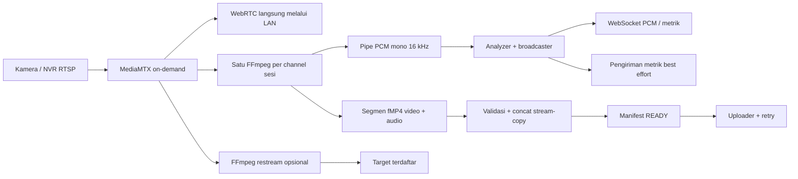

# Memahami mediaengine: satu sesi untuk semua media

Local-app adalah engine media. Cloud menangani login, registrasi, penilaian, dan aturan perlombaan. Tombol **Mulai** membuat satu sesi media; **Stop** menghentikan semua media sesi dan memfinalisasi rekaman. HTTP server, supervisor MediaMTX, uploader, heartbeat, dan pelaporan metadata tetap hidup.

## Mulai membaca dari sini

1. [Model sesi](internal/mediaengine/session/model/session.go): payload, status, dan hasil yang disimpan.
2. [Handler sesi](internal/delivery/rest/session/handler.go): parsing JSON dan response 202.
3. [UseCase sesi](internal/mediaengine/session/usecase/session.go): validasi, reservasi, admission playback, dan koordinasi.
4. [Recording sesi](internal/mediaengine/session/usecase/recording.go): percobaan per channel, retry, penghentian, finalisasi, dan restart.
5. [Journal sesi](internal/mediaengine/session/repository/journal.go): penyimpanan JSON atomik.
6. [Worker sesi](internal/mediaengine/session/worker/worker.go): goroutine dan penantian pekerjaan background.

Handler memanggil interface UseCase. UseCase sesi memanggil audio/restream melalui interface serta memakai model rekaman; tidak mengimpor handler, HTTP, repository konkret, atau adapter. Container di [app](internal/app/container.go) memasang implementasinya. Repository tidak memanggil repository lain.

## Peta tanggung jawab

| Folder | Tugas |
| --- | --- |
| `mediaengine/session` | Pemilik lifecycle tunggal seluruh media, retry channel, disk/duration guard, dan recovery. |
| `mediaengine/channel` | Katalog channel dan alamat playback tanpa membocorkan kredensial sumber. |
| `mediaengine/audio` | Analisis PCM, distribusi PCM/metrik, dan pengiriman metrik best effort. Tidak membuka kamera sendiri. |
| `mediaengine/streaming` | Menjalankan dan memulihkan restream yang dipilih oleh sesi. Tidak punya endpoint mutasi. |
| `mediaengine/saving` | Manifest rekaman, query daftar, upload S3, dan retry upload. Tidak mengendalikan proses recording. |
| `mediaengine/media/ffmpeg` | Pipeline recording/PCM, pemeriksaan/penggabungan MP4, dan adapter restream. |
| `mediaengine/media/mediamtx` | Server RTSP/WebRTC dan sumber on-demand. |
| `delivery/rest/session` | API Mulai/Stop/status. |
| `delivery/whep` | Otorisasi playback cloud, proxy SDP, registry sesi WHEP, dan teardown. |
| `delivery/websocket` | Koneksi audio binary/metrik text dengan subprotocol `edge-v1`. |
| `infra/runtime` | Eksekusi proses OS dan jobgroup background. |
| `cloud` | Polling command, heartbeat, grant playback, dan pelaporan metadata. |

## Ketika aplikasi baru dinyalakan

Server mengunci DATA_DIR dan RUNTIME_DIR, merakit dependency, serta menjalankan supervisor MediaMTX dan worker. Modul audio hanya menyiapkan broadcaster, analyzer, dan pengiriman metrik. Belum ada pipeline recording/PCM atau restream. Kamera di MediaMTX memakai sumber on-demand.

Journal aktif dari boot sebelumnya menjadi `INTERRUPTED`; media tidak dilanjutkan otomatis. Segmen yang tertinggal diperiksa dan diselamatkan sebelum server menerima sesi baru. Startup dapat menunggu pemeriksaan rekaman berukuran besar.

## Ketika Mulai ditekan

```http
POST /api/v1/media/sessions
Authorization: Bearer <token-operator>
Content-Type: application/json

{"id":"session-001","channels":["gantangan01","gantangan02"],"restreams":[{"channel_id":"gantangan01","target":"youtube"}]}
```

`restreams` boleh kosong. Satu target hanya dapat dipakai sekali per sesi. Target harus terdaftar pada `RESTREAM_TARGETS_JSON`; channel restream harus termasuk daftar channel sesi. Daftar ini tetap sampai sesi berakhir. Gunakan ID baru untuk sesi berikutnya.

UseCase memeriksa ID, katalog, channel duplikat, target, kapasitas disk, dan sesi aktif. Sesi lain, termasuk sesi yang masih FINALIZING, ditolak dengan 409. Journal identitas/config sesi disimpan sebelum pekerjaan dimulai, diikuti reservasi manifest per channel. Request berulang dengan ID dan konfigurasi persis sama mengembalikan sesi aktif yang sama selama belum Stop; ID lama tidak dipakai ulang.

HTTP 202 berarti pekerjaan diterima. Pekerjaan berjalan dengan context worker, sehingga browser ditutup atau request berakhir tidak menghentikan recording. Pantau `GET /api/v1/media/sessions/:id` untuk status aktual.



Pipeline menyalin video dan mengubah audio rekaman menjadi AAC. Output kedua adalah PCM mono 16 kHz, frame 200 ms. Drain pipe memakai antrean terbatas 16 frame; broadcaster memakai antrean 8 pesan per subscriber, antrean metrik backend 128 pesan. Konsumen lambat boleh kehilangan frame PCM/metrik tanpa menahan penulisan recording. Restream tetap bisa memakai FFmpeg tambahan; jumlah proses bukan selalu sama dengan jumlah channel.

## Live untuk operator dan juri

Frontend tetap di cloud. Setelah login, browser meminta tiket live dan URL engine arena ke cloud. Browser lalu mengirim SDP WHEP dengan Bearer tiket ke gateway LAN. Gateway meminta grant cloud, memperoleh admission sesi aktif, dan meneruskan signaling ke MediaMTX loopback. Byte media WebRTC bergerak melalui LAN.

Hanya channel dalam sesi aktif yang dapat membuka playback/audio baru. Registry gateway mengaitkan sesi upstream dengan generasi media. URL Location rahasia dipakai PATCH/DELETE. Lease admission memastikan Stop menunggu POST yang sudah diterima sebelum menutup seluruh playback. Registry dikosongkan dan generasi berganti saat teardown; playback lama tidak ikut sesi berikutnya.

Tiket cloud tetap wajib. Cloud terputus menolak playback baru, sementara recording dan playback yang sudah tersambung terus berjalan sampai Stop atau koneksinya terputus. Endpoint pendamping cloud belum aktif dalam pekerjaan ini. HTTPS terpercaya, origin, ICE, firewall UDP, dan izin akses LAN browser masih harus disiapkan.

## Ketika satu channel gagal

Channel menjadi RETRYING, sesi menjadi DEGRADED, dan channel lain terus berjalan. Pipeline mencoba kembali setelah 5 detik; setiap percobaan memakai nama segmen baru. Restream memiliki retry sendiri dan tidak mematikan recording saat target gagal. Status kembali RUNNING setelah seluruh channel dan restream pulih.

Manifest mencatat awal/akhir setiap percobaan serta gangguan. `source_interruption` menandai celah sumber; `restart_uncertain` menandai interval percobaan yang terputus tanpa penutupan bersih, bukan klaim bahwa seluruh interval kehilangan media. GET status sesi memperlihatkan `channel_states`, `attempts`, `segment_count`, `gaps`, `recording_state`, dan alasan kegagalan. Tidak ada kredensial RTSP atau path file lokal dalam response.

## Ketika Stop ditekan

```http
POST /api/v1/media/sessions/session-001/stop
Authorization: Bearer <token-operator>
```

Response 202 mengembalikan status STOPPING; ini belum berarti semua media sudah berhenti. Stop berulang idempoten. Urutan pekerjaan:

1. Tutup admission, cancel context pipeline/retry, dan nonaktifkan subscription/audio metrik.
2. Tunggu POST WHEP yang telah mendapat admission, kemudian tutup sesi upstream dan WebSocket. Kegagalan teardown WHEP memicu penutupan MediaMTX; supervisor menjalankannya kembali. Jika penutupan tidak dapat dipastikan, sesi tidak dinyatakan STOPPED.
3. Hentikan restream dan tunggu seluruh pipeline recording/PCM keluar. FFmpeg menerima `q`; setelah batas 15 detik proses dipaksa berhenti dan segmen diperiksa saat finalisasi.
4. Masuk FINALIZING. Segmen yang memiliki media divalidasi dengan ffprobe, partial diremux ke artefak salvage terpisah, lalu codec/extradata dibandingkan.
5. Gabungkan segmen berurutan memakai stream-copy ke file sementara. Validasi hasil, flush, lalu rename atomik ke MP4 final.
6. Rekaman valid menjadi READY; kegagalan menjadi FAILED dengan alasan. Sesi menjadi STOPPED setelah semua hasil ditentukan. Upload tidak menjadi syarat Stop selesai. Bila penyimpanan status akhir gagal, sesi tetap FINALIZING dengan alasan; Stop dapat diulang untuk menyelesaikan pencatatan tanpa menimpa hasil upload yang sudah tersimpan.

Tidak ditambahkan frame hitam/audio senyap pada celah. Durasi MP4 dapat lebih pendek daripada waktu sesi; `gaps` menjelaskan gangguannya. Codec yang berubah membuat finalisasi gagal. Sumber segmen dipertahankan untuk pemeriksaan, tanpa transcoding otomatis. Artefak sumber/salvage menggunakan disk tambahan dan tidak dibersihkan otomatis pada fase ini.

## Status dan penyimpanan

```text
STARTING → RUNNING ↔ DEGRADED → STOPPING → FINALIZING → STOPPED
restart sebelum terminal → INTERRUPTED
kegagalan startup → FAILED
```

| Lokasi | Isi |
| --- | --- |
| `DATA_DIR/media-sessions/<id>.json` | Identitas, pilihan channel/restream, state dan status channel sesi. |
| `DATA_DIR/queue/<recording-id>.json` | Manifest hasil dan retry upload, ditambah field opsional segments/gaps/error. |
| `DATA_DIR/recordings/` | Segmen per percobaan, salvage, dan MP4 final. |
| `DATA_DIR/commands/` | Journal command/hasil/ack cloud. |
| `RUNTIME_DIR/mediamtx.yml` | Konfigurasi media hasil render. |

`round_id` dan object key `rounds/<session>/<channel>/<recording>.mp4` tetap dipertahankan untuk kompatibilitas. Manifest READY/UPLOADED lama tetap diproses. File partial tidak dianggap lengkap hanya karena berukuran positif. Proses media dimiliki engine melalui Job Object Windows/parent-death signal Linux, agar crash engine tidak membiarkan recording lama berjalan.

## Upload dan cloud setelah Stop

Worker saving tetap memilih manifest READY dan menyimpan status UPLOADED atau jadwal retry. Worker cloud tetap mengirim metadata sampai mendapat acknowledgment. Command cloud yang diterima sekarang hanya `media.session.start` dan `media.session.stop`; hasil sukses command berarti permintaan lifecycle diterima, bukan finalisasi selesai. Command lama tidak didukung.

## Batas verifikasi

Lihat [skenario penerimaan](SESSION-ACCEPTANCE.md). Build dan percobaan sumber sintetis tidak membuktikan playback browser LAN, HTTPS, target restream nyata, atau S3 produksi sudah siap. Penerimaan operasional memerlukan perangkat dan jaringan arena.
